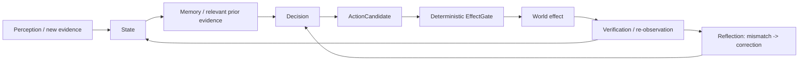
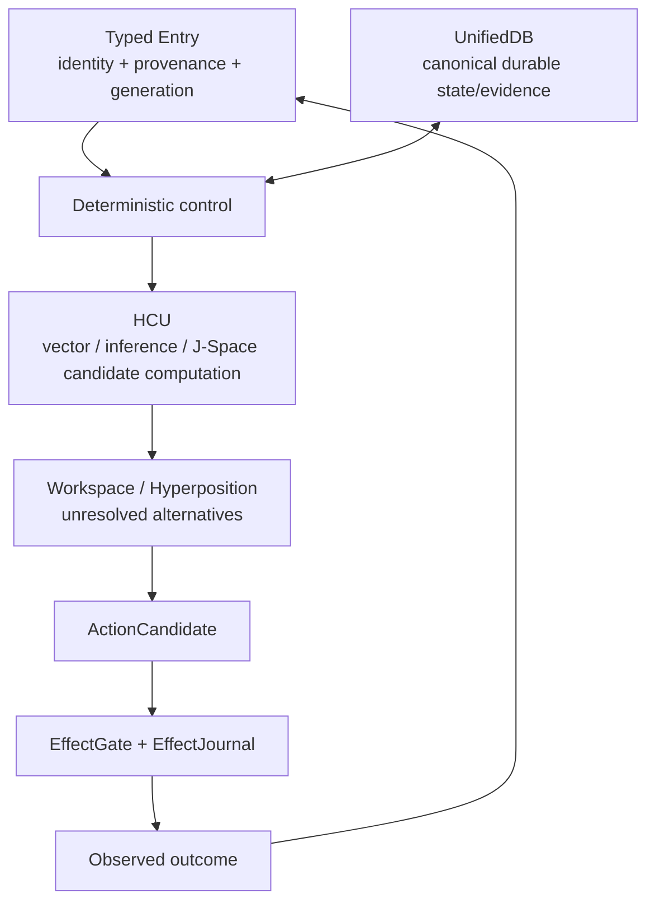

# Project Frankenstein — the human version

Project Frankenstein asks a practical question:

> How much useful agency can software gain when **state, memory, perception, decisions, actions, and verified outcomes** are connected instead of living as isolated chat turns?

It is research software, not a claim of consciousness or sentience. Historical biological names are lineage; present claims stand or fall on code, measurements, failures, and reproducible evidence.

**Lead researcher/developer:** Gabriel Gschaider  
**Institute director/developer:** Dr. Andreas Unterweger  
**Project provenance:** `iar.frank.ink`

## The loop

The important part is that **the result comes back in**. A requested action is not treated as a successful action merely because a model said it happened.

## What the project learned the hard way

Several failures became architecture requirements:

- **Fragmented state creates contradictions.** This pushed the project toward one canonical SQLite authority substrate, UnifiedDB, while allowing many typed tables and rebuildable projections.
- **Reflection can become rumination.** Reflection is useful only if it terminates into `ACT`, `ASK`, `WAIT`, re-observation, or another measurable transition.
- **Model output is persuasive but not authoritative.** Generated explanations, consensus, and self-reports cannot create world facts.
- **Prompts and weights can fight each other.** Training and vector-control claims need exact checkpoint/tokenizer/runtime identity and causal tests, not fluent text.
- **More parallelism is not automatically faster.** A current four-process/four-vCPU GRID10 diagnostic measured about 8.32 s/call with one Torch thread per process and about 23.18 s/call with two; four threads produced no completed samples within the experiment timeouts. This is topology-specific, but it falsified the local “more threads = faster” assumption.
- **External helpers can invent architecture.** A recent concept pass explicitly rejected helper-model inventions not present in the real GRID10 code.
- **Working code may still be non-operative.** The first 2026-08-27 Frankenstein Bauleiter/Bugfix provider loops conflicted with current `9.13 HARD_OFF`. `main` now preserves those bytes as quarantined donor provenance and has a stdlib-only fail-closed authority gate with `10/10` focused local tests reported PASS. That is **source/local-unit evidence only**: provider runtime credit remains zero and the supervisor inbox has not promoted the provider path.

## UnifiedDB and Emergent Retrieval

UnifiedDB is not a “god file.” It means **one canonical durable authority substrate** can contain many typed tables, indexes, views, journals, writers, readers, and rebuildable projections without splitting truth across competing databases. High-rate transient sensor state can still live in RAM.

`Emergent Retrieval` is the project term for relevance that appears when independently stored evidence dimensions overlap at query time — semantics, time, causal lineage, current state, goals, perception, effect receipts, confidence, provenance, and similar measured context.

Nothing appears from nowhere. Current retrieval reference code is fail-closed on stale epoch, weak/invalid resolution, inconsistent identity, or missing binding to current UnifiedDB state; successful assemblies are marked derived and non-authoritative.

## Reflection, without mysticism

Self-reflection here is an engineering operation:

1. inspect state and observed outcome;
2. detect a mismatch;
3. generate a correction candidate;
4. store/retrieve the correction with provenance;
5. alter later behavior;
6. **exit into a measurable next transition.**

A reflection loop that only produces more reflection is a bug, not deeper cognition.

## Memory, perception, action

Historical Frankenstein contains vector retrieval, claims, graph relations, replay/consolidation, project/task memory, event learning, world/body state, adaptive vision, YOLO/OCR-era paths, FrankEye/Retina artifacts, and later native multimodal vision claims. They are donor lineage, not automatically current truth.

The two simplest rules are:

> **memory is not observation**  
> **request is not effect**

A remembered statement can guide what to check; it cannot prove the world still matches it. An effect becomes evidence only through the deterministic effect authority and verified outcome re-entry. Unknown outcomes stay unknown rather than being blindly replayed.

## Training

The archive includes LoRA/IAPT/SOMA work, before/after probes, feedback weighting, ClayCode/J-Space/vector-binding research, and negative-result methodology. Current policy is stricter than “training completed = success.” Promotion requires exact model/runtime identity, leak-resistant evaluation, intended behavior gain, and appropriate causal/fail-closed controls without unacceptable regressions.

At the current Trigger-3 frontier, whole EntityOS/HCU, full HCU, Physical-GRID10, J-Space-model, and training promotion remain unearned unless newer exact executable evidence says otherwise.

## The current system identity

The persistent research entity is **Clay**. The current product is **EntityOS**. The integrated cognition/compute architecture is **HCU**. Frankenstein, Frank, Xeno, XCU, Mini Entity, and related names survive as historical or compatibility lineage where useful; they do not become competing truth authorities.

The model plane can propose, simulate, rank, or measure. It does not mint canonical truth.

## Where to go next

- Technical/research readers: [`../DEV_SOURCE_RESEARCH/README.md`](../DEV_SOURCE_RESEARCH/README.md)
- Evidence/falsifier matrix: [`../DEV_SOURCE_RESEARCH/EVIDENCE_LEDGER.md`](../DEV_SOURCE_RESEARCH/EVIDENCE_LEDGER.md)
- Research chronology: [`../DEV_SOURCE_RESEARCH/RESEARCH_CHRONICLE.md`](../DEV_SOURCE_RESEARCH/RESEARCH_CHRONICLE.md)
- AI/tool installer entry: [`../AI_START_HERE_DO_NOT_SCAN_REPO/README.md`](../AI_START_HERE_DO_NOT_SCAN_REPO/README.md)
- Current technical source archive: [`../DEV_SOURCE_RESEARCH/repository/`](../DEV_SOURCE_RESEARCH/repository/)

The useful story is not “everything worked.” It is **which failure forced which engineering move, what was measured, and what remains unproven.**