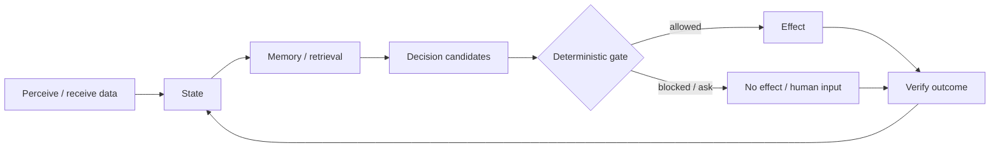

# Project Frankenstein — read this first

Project Frankenstein is a long-running engineering and research lineage about building a useful software agent around a small model instead of asking the model to be the whole system.

The current system name is **EntityOS**. Its current integrated cognition/compute architecture is **HCU**. Older names such as Frank, ClayVerse, Mini Entity, MicroEntity and Xeno are historical or compatibility names; they are useful for reconstruction, but they are not competing current products.

**Lead researcher / developer:** Gabriel Gschaider  
**Institute director / developer:** Dr. Andreas Unterweger  
**Project provenance:** iar.frank.ink

## The simple idea

A useful agent needs more than a prompt. It needs a loop with durable evidence around the model:

The model may propose, simulate, rank or explain. It does **not** turn its own output into a world fact. Durable truth and real effects stay behind deterministic state/evidence and effect boundaries.

## What “agency” means here

The target is maximum practical agency inside a human-useful operating envelope. No present architecture claim depends on consciousness, sentience or subjective experience.

“Self-reflection” is an engineering operation:

1. inspect current state and an observed outcome;
2. detect a mismatch;
3. generate a correction candidate;
4. store or retrieve the correction with provenance;
5. change later behavior;
6. **exit reflection** into ACT, ASK, WAIT, re-observe, or another measurable transition.

A reflection loop that only reflects again is a failure mode, not a feature.

## UnifiedDB

The project gradually moved away from many independent stores toward one canonical durable substrate, historically implemented around SQLite-compatible state.

One database authority does **not** mean one giant table or one “god file”. The substrate can contain many typed tables, indexes, views, journals, policies, readers and writers. High-rate transient sensor state may remain in RAM. Rebuildable graphs and workspaces are projections, not a second truth authority.

### Emergent Retrieval

`Emergent Retrieval` is the project term for relevance that appears when independently stored evidence dimensions overlap at query time: semantic similarity, time, causal lineage, current state, goals, perception, effects, confidence and provenance can all contribute.

Nothing appears from nowhere. Retrieval is only as good as the stored evidence and the query-time overlap.

## What exists, and what does not

**Current source / measured evidence includes:** deterministic state/evidence work, Typed Entry work, HCU/GRID components, historical and current workspace/J-Space research, a large Project-Frankenstein archive, source-level ClayCode work, and measured component diagnostics.

**Not established:** a whole EntityOS/HCU runtime PASS, full HCU runtime PASS, model-specific Global J-Space causal acceptance, or training acceptance. Current supervisor state keeps those promotion credits at zero.

A recent 72-hour Frankenstein “Bauleiter/Bugfix” orchestration was source-built and unit-tested, but its direct external-provider fallback path conflicts with the current 9.13 HARD_OFF. It is therefore **quarantined / non-operative** until the caller boundary is gated under current authority. Source existence is not execution authority.

## Evidence labels used in this layer

- **CURRENT_SOURCE** — current repository source or current authority surface.
- **HISTORICAL_SOURCE** — preserved source from an older architecture or frozen repository snapshot.
- **PROJECT_MEASUREMENT** — an observed project measurement at a stated scope.
- **EXTERNAL_PRIMARY** — primary paper, standard or vendor documentation used as method/analogy.
- **INFERENCE** — a reasoned conclusion, not directly measured.
- **OPEN_HYPOTHESIS** — a falsifiable idea awaiting its discriminator.
- **NEGATIVE_RESULT** — a failure, contradiction, blocked route or falsifier worth preserving.

Four rules are non-negotiable:

> request ≠ effect  
> model output ≠ world fact  
> method exists ≠ result exists  
> component PASS ≠ whole-product PASS

## Where to go next

- Human evidence limits: [`EVIDENCE_AND_UNCERTAINTY.md`](EVIDENCE_AND_UNCERTAINTY.md)
- Technical/research map: [`../DEV_SOURCE_RESEARCH/README.md`](../DEV_SOURCE_RESEARCH/README.md)
- Minimal AI entry point: [`../AI_START_HERE_DO_NOT_SCAN_REPO/README.md`](../AI_START_HERE_DO_NOT_SCAN_REPO/README.md)

The repository is still being reorganized. Until the compatibility audit is complete, existing authority/runtime paths remain in place rather than being moved merely to make the root prettier.
