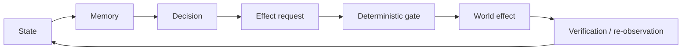

# Project Frankenstein — read this first

This repository is a research and engineering record for **Project Frankenstein** and its current descendant work around **EntityOS + HCU**. It contains working code, experiments, failed ideas, measurements, archived source, and a large amount of evidence about how the architecture changed.

**Lead researcher / developer:** Gabriel Gschaider  
**Institute director / developer:** Dr. Andreas Unterweger  
**Project provenance:** iar.frank.ink

## The shortest useful explanation

Frankenstein is an attempt to build practical machine agency from a system, not from one giant prompt. The recurring engineering loop is:

The important part is the loop back. A generated answer is not treated as a world fact. A requested action is not treated as an executed action. An effect is not considered known until the system can observe or verify what happened.

## What exists today

**CURRENT_SOURCE — source-level architecture.** The current EntityOS code contains a SQLite/WAL `UnifiedDB` with typed tables for users, sessions, turns, durable memory, workspace episodes, effects, causal episodes, active turns, leases, checkpoints, graph projections, retrieval episodes and retrieval feedback. Its own source says it is the "Single canonical state authority" and that ClayGraph tables are rebuildable projections only. See [`UnifiedDB` source](../DEV_SOURCE_RESEARCH/repository/the%20artefact/clayverse/store.py).

**CURRENT_SOURCE — Emergent Retrieval.** The repository also contains fail-closed retrieval code that starts from an admitted evidence-bound seed and builds a bounded derived assembly. If identity, confidence, epoch or binding is wrong, propagation is blocked. The result explicitly says `persistent_second_store: false` and `authority: ASSEMBLY_CONTEXT_ONLY`. See [`FailClosedEmergentRetrievalCascade`](../DEV_SOURCE_RESEARCH/repository/research_entity/harness/reference/unifieddb_emergent_cascade.py).

**PARTIAL_COMPONENT_EVIDENCE — Hyperposition / GWT / GRF.** These are active research directions, not finished facts. The current cache says exact-merge singleton repair exists at component source/test scope, while physical GRID10 Hyperposition/GWT re-entry remains blocked pending stronger runtime evidence. See [`hyperposition-gwt-grf.md`](../DEV_SOURCE_RESEARCH/repository/research_entity/00_CURRENT/latest/hyperposition-gwt-grf.md).

**NEGATIVE_RESULT / CURRENT_AUTHORITY — provider orchestration.** The newest Frankenstein Bauleiter/Bugfix scripts have source tests, but the current supervisor state says their external provider loops are *not operationally authorized* under 9.13 HARD_OFF. They must not be presented as an admitted autonomous runtime. See [`SUPERVISOR_INBOX.json`](../DEV_SOURCE_RESEARCH/repository/research_entity/claycode/autonomous/SUPERVISOR_INBOX.json).

## UnifiedDB without mysticism

UnifiedDB is not a "god file". It is one authority substrate with many typed tables, indexes, readers, writers and policies. High-rate transient sensor state may still live in RAM. Derived graph or retrieval structures can exist as rebuildable projections without becoming a second truth store.

The reason for the consolidation is engineering: when state is spread across unrelated databases and services, it becomes difficult to prove which copy is authoritative, which generation is current, and whether an action was based on stale state. One coherent substrate reduces those ownership and copy boundaries.

A useful analogy is hardware unified memory: reducing unnecessary ownership/copy boundaries can make computation over shared state simpler. The analogy ends there; hardware memory coherence does **not** supply database semantics, provenance or effect authority.

## Emergent Retrieval

`Emergent Retrieval` is the project term for relevance that appears when independently stored evidence dimensions overlap at query time: semantic match, temporal context, causal lineage, current state, goals, perception, effects, confidence and provenance.

Nothing appears from nowhere. Retrieval assembles already-stored evidence into a context under explicit bounds and receipts. If the seed cannot be bound to current UnifiedDB identity, the cascade fails closed.

## Reflection is an engineering operation

No present architecture claim requires consciousness, sentience or subjective experience. Historical bio-inspired names remain part of the lineage, but current framing is functional.

A useful reflection cycle is:

1. inspect state and the observed outcome;
2. detect a mismatch;
3. generate a correction candidate;
4. store or retrieve the correction with provenance;
5. alter a later decision;
6. **terminate** into `ACT`, `ASK`, `WAIT`, re-observe, or another measurable state transition.

A reflection process that only produces more reflection is a failure mode, not more agency.

## Why the failures matter

Project Frankenstein accumulated useful negative evidence: rumination/fixation, prompt-vs-weight conflicts, context contamination, latency/timeouts, integration failures, dead modules, provider-authority violations, memory fragmentation and experiments that did not survive stronger measurement. These are kept because they explain why later architecture moved toward deterministic state, provenance, bounded effects, replayable receipts and explicit exit conditions.

The research archive is evidence, not an oracle. Repetition or model consensus does not create independent proof.

## Where to go next

- **Technical reader:** [`DEV_SOURCE_RESEARCH/README.md`](../DEV_SOURCE_RESEARCH/README.md)
- **Research chronology / evidence graph:** [`DEV_SOURCE_RESEARCH/RESEARCH_CHRONICLE.md`](../DEV_SOURCE_RESEARCH/RESEARCH_CHRONICLE.md)
- **Exact claim ledger:** [`DEV_SOURCE_RESEARCH/EVIDENCE_LEDGER.md`](../DEV_SOURCE_RESEARCH/EVIDENCE_LEDGER.md)
- **AI installer / integration contract:** [`AI_START_HERE_DO_NOT_SCAN_REPO/README.md`](../AI_START_HERE_DO_NOT_SCAN_REPO/README.md)

The root `README.md` is intentionally preserved byte-for-byte in this curation branch. Triggerword 3 does not silently rewrite it.