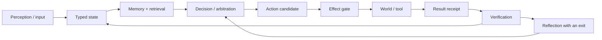

# Project Frankenstein — what this repository is trying to build

Project Frankenstein is an engineering research programme about **practical agency**: a software system that can keep useful state, remember what mattered, decide what to do next, act through controlled tools, observe what actually happened, and correct itself when the result differs from the plan.

It is not a claim about consciousness or sentience. The project uses some historically bio-inspired names, but the engineering question is simpler: **can a machine keep a sufficiently coherent external state-and-memory substrate to improve its later behaviour without confusing its own guesses with reality?**

Project provenance: **iar.frank.ink**. Lead researcher/developer: **Gabriel Gschaider**. Institute director/developer: **Dr. Andreas Unterweger**.

## The whole idea in one loop

The important word is **receipt**. Asking a tool to do something is not proof that it happened. A model saying something happened is also not proof. The loop is only useful when an observed result comes back and can change later state.

## What the pieces mean

### State

The project has repeatedly moved away from scattered, competing stores toward a canonical SQLite-based substrate called **UnifiedDB** (or compatibility descendants where migration is incomplete). “Unified” does not mean “one giant table”. It means one authority boundary can contain many typed tables, indexes, journals, views and policies while fast transient sensor state can still live in RAM.

The design reason is mundane and important: when memory, goals, perception, effects and provenance live in unrelated stores, the system spends increasing effort deciding which copy of reality is authoritative.

### Emergent Retrieval

**Emergent Retrieval** is the project term for relevance that appears when independently stored evidence dimensions overlap at query time: semantic similarity, recency, causal lineage, current state, goals, perception, effect history, confidence and provenance can all contribute.

Nothing is created from nowhere. It is retrieval from stored evidence under several simultaneous constraints.

### Memory

Memory is not automatically truth. A stored statement may be a measurement, an old hypothesis, a failed experiment, a model suggestion, or a human instruction. The research archive therefore keeps provenance and status close to the content instead of flattening everything into one polished story.

### Decision and workspace

The project has explored Global Workspace / GWT-inspired arbitration and a **Global J-Space** interface: multiple candidate signals can compete, converge or remain unresolved. The engineering hypothesis is that a shared, measurable coordination surface may be useful for routing cognition and later training.

That remains an **empirical hypothesis**, not proof that a language model literally implements a biological global workspace.

### Hyperposition

**Hyperposition** means preserving multiple unresolved alternatives instead of forcing a premature single answer. Majority vote or repeated wording cannot turn uncertainty into fact. Alternatives should collapse only when evidence or an explicit policy provides a reason.

### Perception

Historical work includes visual/perceptual pipelines and “Retina”/Visual Cortex ideas. The current evidence rule is deliberately stricter than the old naming: a sensor packet, screenshot, model description and verified environmental observation are different things and should remain distinguishable.

### Action

The architecture separates a model-produced **candidate** from a real effect. Real state-changing effects belong behind deterministic gates and journals. This is how the project tries to keep high agency compatible with human control and post-hoc reconstruction.

### Self-reflection — with an exit

Reflection is treated as a control operation, not mystical introspection:

1. compare intended and observed outcome;
2. detect a mismatch;
3. propose a correction;
4. store/retrieve the correction with provenance;
5. change later behaviour;
6. **exit** into `ACT`, `ASK`, `WAIT`, re-observation, or another measurable state transition.

A reflection loop that only produces more reflection is a failure mode, not deeper cognition.

## Frankenstein, EntityOS and HCU

The research history contains several names. They are not all current product identities.

- **Project Frankenstein / Frank** — historical and current research lineage for the agentic architecture and its concrete implementation work.
- **Clay** — the persistent research entity used to carry evidence and continuity across temporary workers.
- **EntityOS** — the current product/system identity in the canonical research authority.
- **HCU** — the current integrated cognition/compute architecture under EntityOS.
- **Xeno / XCU / Mini Entity / MicroEntity / ClayVerse** — compatibility, transitional or historical names; useful for archaeology, not competing current authorities.

## What is real right now, and what is not

This curated layer is intentionally conservative. At branch base `854f6bc87780f4a5242489a6c807d186b16a8c3d` (2026-08-27), current supervisor state still reports:

- whole EntityOS runtime credit: **0**;
- full HCU runtime credit: **0**;
- physical GRID10 runtime credit: **0**;
- canonical semantics credit: **0**;
- training credit: **0**;
- accepted canonical dataset rows: **0**;
- Distillery accepted dataset tokens, last confirmed: **0 / 88,774 collected source tokens**.

That does **not** mean “nothing works”. It means component results are not silently promoted into whole-system claims.

One recent diagnostic result is useful and bounded: on the measured four-process/four-vCPU GRID10 topology, one Torch intra-op thread per process averaged about 8.32 s/call, two threads averaged about 23.18 s/call, and four threads completed no samples inside the experiment timeouts. This supports the existing one-thread default **for that measured topology only**.

The newest Frankenstein Bauleiter/Bugfix/Paket source also reports 29 local tests passing. Those are source/component test results, not permission to run its external-provider loop and not whole-product acceptance.

## A current safety/authority wrinkle worth understanding

The newest Frankenstein watchdog/orchestrator source contains direct Nemotron → Groq → Mistral fallback logic. The current canonical supervisor epoch is **9.13 HARD_OFF** for external provider routes, with Together forbidden and no paid fallback. Therefore that provider-calling orchestration is currently **quarantined / non-operative** even though its local tests pass.

This is a useful example of the project’s evidence discipline:

> Code can be syntactically correct, locally tested, and still not be authorized or product-valid in the current system state.

Local and designated `clay-direct-dev` VPS sandbox development remain separately owner-authorized. External provider calls do not become authorized merely because a sandbox is authorized.

## Why UnifiedDB matters to the research lineage

Early agent systems often grow by adding a new database or service for every new faculty: chat history here, vector memory there, goals elsewhere, tool logs somewhere else. Frankenstein repeatedly hit the cost of those ownership boundaries.

The UnifiedDB direction is a reaction to that failure mode. The analogy sometimes used in the project is NVIDIA Unified Memory: reduce awkward ownership/copy boundaries so compute can work over a coherent substrate. It is only an analogy. CUDA memory coherence is not database semantics, and SQLite does not become GPU memory because the analogy is useful.

## Why negative results stay visible

The repository contains failed integrations, dead modules, prompt-vs-weight conflicts, rumination/fixation, timeouts, latency problems, context contamination, zero-yield dataset funnels and provider-authority failures. They are not embarrassing debris to hide. They explain why the architecture changed.

A few recurring lessons:

- a request is not an effect;
- a model answer is not a world fact;
- a method being implemented does not mean its target result exists;
- repeated model agreement is not independent replication;
- a component test passing does not make the product pass;
- a memory item is not the same as a fresh observation;
- a source-ready path is not runtime evidence;
- reflection without a measurable exit can become rumination;
- fragmented state stores create authority ambiguity;
- an attractive internal-vector interpretation needs intervention/lesion controls before it earns a causal claim.

## Where to go next

For the technical evidence graph, status vocabulary, source paths, measurements, counter-hypotheses and external primary literature, go to:

- [`../DEV_SOURCE_RESEARCH/README.md`](../DEV_SOURCE_RESEARCH/README.md)
- [`../DEV_SOURCE_RESEARCH/research/FRANKENSTEIN_EVIDENCE_CHRONICLE.md`](../DEV_SOURCE_RESEARCH/research/FRANKENSTEIN_EVIDENCE_CHRONICLE.md)

If you are an AI or coding agent trying to install or adapt Frankenstein, do **not** scan the repository root first. Start here instead:

- [`../AI_START_HERE_DO_NOT_SCAN_REPO/README.md`](../AI_START_HERE_DO_NOT_SCAN_REPO/README.md)

The root is still historically cluttered. The curated layer is being added before destructive moves so old deep links and evidence identities are not broken just to make the front page prettier.
