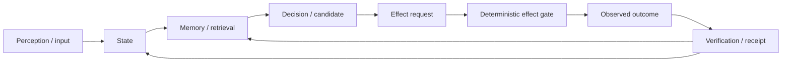

# Project Frankenstein — human entry

This folder is the short human-readable entrance to Project Frankenstein.

**Provenance:** `iar.frank.ink`  
**Lead researcher / developer:** Gabriel Gschaider  
**Institute director / developer:** Dr. Andreas Unterweger

## What this project is

Project Frankenstein is an engineering and research program about building software that can keep state, remember what happened, choose an action, observe the result, and change later behavior from verified outcomes.

The current product identity in the research repository is **EntityOS**. The current integrated cognition/compute architecture is **HCU**. Older names such as Frank, ClayVerse, Mini Entity, MicroEntity, Xeno and XCU are useful for lineage or compatibility, but they must not silently become competing current products or truth stores.

The central loop is deliberately ordinary:

The difficult part is not drawing the loop. The difficult part is making every arrow auditable, terminating, recoverable after failure, and honest about what is known versus guessed.

## One state substrate, not one giant file

The project converged away from many loosely synchronized databases and services toward a canonical SQLite-based state/evidence substrate, historically called UnifiedDB or MiniUnifiedDB in different implementation epochs.

That does **not** mean "put everything in one giant table." A single authority substrate can still contain many typed tables, indexes, views, journals, writers, readers and rebuildable projections. High-rate transient sensor state can remain in RAM. The design goal is one answer to "what state is authoritative?", not one data structure for every workload.

## Emergent Retrieval

`Emergent Retrieval` is the project term for relevance that appears when independently stored evidence dimensions overlap at query time. Examples include semantic similarity, time, causal lineage, current state, goals, perception, effects, confidence and provenance.

Nothing appears from nowhere. The information was already stored. What emerges is the *relevance ordering* produced by multiple constraints meeting at the same query.

## Reflection must end

Self-reflection is treated as an engineering control operation, not as a claim about consciousness.

A useful reflection step can:

1. inspect state and the last outcome;
2. detect a mismatch;
3. generate a correction candidate;
4. store or retrieve the correction;
5. change later behavior.

But reflection that only produces more reflection is a failure mode. A reflective cycle must terminate into a measurable transition such as **ACT**, **ASK**, **WAIT**, **RE-OBSERVE**, or another bounded state transition.

## Global workspace, GRF, Hyperposition and J-Space

The repository contains a long lineage of workspace/GWT, GRF, Hyperposition and Global J-Space research. These mechanisms are treated as engineering hypotheses and interfaces, not as evidence that the software is conscious or sentient.

The current repository cache explicitly labels Hyperposition/GWT/GRF as `PARTIAL_COMPONENT_EVIDENCE`: component-level repair exists, while physical GRID10 re-entry and stronger causal tests remain open. That distinction matters.

## Perception and action

Historical Frankenstein code contains several perception lineages, including visual pipelines, gating/attention code and later multimodal replacements. The research archive preserves superseded implementations because failures and replacement paths explain why the architecture changed.

Action is separated from model text. A model can propose a candidate. Real state-changing effects must pass deterministic authority and be recorded with outcome evidence. A request is not an effect; a successful submission is not necessarily a known outcome; an unknown outcome stays unknown until verified.

## Memory and training

The project has experimented with retrieval, graph/vector memory, replay, forgetting, LoRA/IAPT/SOMA-style training and later J-Space/vector-control specialization ideas.

Training is not credited merely because a training job completed. The current authority state still records **training credit = 0** and **canonical admitted dataset rows = 0** at the strongest current supervisor surface reviewed for this entry layer. That negative result is important: the research may be extensive while the release-grade causal training gate remains open.

## What failed, and why it matters

The archive intentionally keeps failures visible. Important examples include:

- rumination/fixation and recursive loops that did not terminate cleanly;
- context contamination and prompt/weight conflicts;
- latency, CPU oversubscription and timeout failures;
- fragmented state across services/databases;
- provider orchestration that violated a later HARD_OFF authority boundary;
- component tests that were real but too narrow for whole-system claims;
- generated or external model suggestions that invented nonexistent architecture;
- Distillery/Forge collection with zero accepted dataset-token yield at the latest confirmed supervisor state.

A negative result is not dead weight. It constrains the next design.

## Current honesty line

As of the repository state used to build this entry layer on 2026-08-27:

- current canonical repo head inspected: `854f6bc87780f4a5242489a6c807d186b16a8c3d`;
- current supervisor inbox selected 9.13O non-authority steering on top of provider epoch 9.13;
- provider state: HARD_OFF / all provider routes false / Together forbidden / no paid fallback;
- whole EntityOS runtime credit: `0`;
- full HCU runtime credit: `0`;
- physical GRID10 runtime credit: `0`;
- canonical semantics credit: `0`;
- training credit: `0`;
- a real GRID10 4-process/4-vCPU thread-count A/B supported 1 torch thread/process for that topology and falsified the recommendation that 2 threads/process would be faster;
- the new 72-hour provider-calling Frankenstein Bauleiter/Bugfixer plan is quarantined and must not be deployed unchanged under HARD_OFF.

These statements are deliberately narrower than "the system works".

## Where to go next

- Technical/research synthesis: `../DEV_SOURCE_RESEARCH/README.md`
- Evidence-oriented trigger-3 report: `../DEV_SOURCE_RESEARCH/repository/FRANKENSTEIN_TRIGGER3_SYNTHESIS_2026-08-27.md`
- AI/tool installation entrance: `../AI_START_HERE_DO_NOT_SCAN_REPO/README.md`

The repository root is currently still technically cluttered. This folder is a non-destructive first curation layer; it does not pretend that the final root topology migration has already been completed.