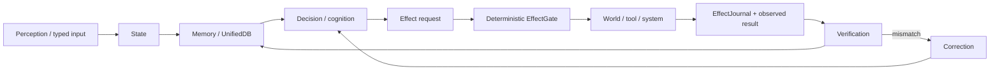

# Project Frankenstein — Human Read This

> **Navigation layer, not authority.** This page explains the project. It does not override current owner/supervisor authority, executable evidence, or canonical state.

## What this project is

Project Frankenstein is a long-running research and engineering effort to build **persistent, agentic, adaptive cognitive software** that can remember, observe, decide, act, verify what happened, and improve its next decision without pretending that model output is reality.

The current product/system identity in the canonical research state is **EntityOS**. The current integrated cognition/compute architecture is **HCU**. Older names such as Frank, ClayVerse, Mini Entity, Xeno, and XCU are useful historical or compatibility labels, but they are not additional competing products or persistent identities.

Public project provenance: **iar.frank.ink**. Project Frankenstein credits **Gabriel Gschaider** as lead researcher/developer and **Dr. Andreas Unterweger** as institute director/developer. These public provenance roles do not replace the repository's machine-readable governance/authority files.

## The core loop

The important part is the return arrow. An action request is not an effect. A model's belief that something happened is not evidence that it happened. The system must re-observe or receive a trustworthy result, record it, and feed that result back into later behavior.

## UnifiedDB: one authority substrate, not one giant blob

The project repeatedly encountered state fragmentation: separate memories, graphs, event stores, helper databases, and ad-hoc caches could disagree about what was current. The engineering direction therefore collapsed durable state/evidence toward **one canonical SQLite-based authority substrate** (UnifiedDB or its admitted compatibility form).

"One database" does **not** mean "one table" or "put everything in one file and hope." A coherent authority substrate can contain many typed tables, indexes, views, journals, writers/readers, policies, and rebuildable projections. High-rate transient sensor state can still live in RAM when it is not durable truth.

### Emergent Retrieval

`Emergent Retrieval` is the project term for relevance that appears when independently stored evidence dimensions overlap at query time — for example semantic similarity + time + causal lineage + current state + goals + perception + effect history + confidence + provenance.

It does **not** mean that information appears from nowhere. The retrieved relationship must be traceable to stored evidence and query-time composition.

## Reflection is a control operation, not a mood

In this project, self-reflection means:

1. inspect current state and the last observed outcome;
2. detect a mismatch between intended and observed result;
3. generate or select a correction;
4. store/retrieve the correction with provenance;
5. change later behavior;
6. **exit reflection into a measurable transition**: `ACT`, `ASK`, `WAIT`, re-observe, or another bounded state change.

A reflection loop that only produces more reflection is a failure mode (rumination/fixation), not agency.

## What HCU is

HCU is the current integrated cognition/compute architecture. It is a software architecture, not a claim of custom silicon. Its useful decomposition is:

- **typed Entry I/O** — new data enters through deterministic admission/provenance boundaries;
- **canonical state** — durable truth/evidence remains outside model-generated cognition;
- **deterministic control** — routing, leases, generation/provenance checks, and effect authority;
- **shared-weight/vector/inference/J-Space plane** — candidate cognition and measurements;
- **typed causal interconnect** — packets/workspace/Hyperposition connections;
- **EffectGate + EffectJournal** — the only real state-changing effect authority.

Logical HCU cells are not automatically resident models or parallel physical decoders.

## Global J-Space / GWT

Global J-Space/GWT is treated as an **empirical coordination/interface hypothesis**. Textual coherence, model self-report, recurrence, majority vote, or repeated labels do not prove a causal model-internal workspace. Promotion requires model/runtime-specific intervention evidence and exact causal traces.

## Hyperposition and GRF

Hyperposition keeps unresolved alternatives alive instead of turning uncertainty into a fake fact. GRF/HyperMath work in the archive explores typed, proof-carrying or causal representations for reasoning/control. Some artifacts are executable prototypes or synthetic receipts; those scopes must not be inflated into whole-product validation.

## ClayCode

ClayCode is the project's internal-language/compiler research line. The repository contains compiler prototypes, acceptance contracts, lowering experiments, validation tools, and historical runtime bridges. Current BASE/release status is deliberately stricter than "a compiler script runs": current supervisor state still keeps broad release gates open.

## Training

Training is a means, not a proof. The target direction is a small local model specialized for the HCU/J-Space/vector-control protocol, but **completed training alone is never PASS**. A useful trained model must demonstrate the intended causal behavior on clean holdouts/interventions while retaining required language, logic, protocol and safety behavior.

Current canonical supervisor authority (2026-08-27, epoch 9.13) is FREE_ONLY/HARD_OFF for provider routes and forbids Together/paid fallback. Historical plans that mention a Together run or persistent free-provider loops do not authorize them.

## Failure is part of the architecture

The repository deliberately preserves negative results because they explain why the architecture changed. Important current examples include:

- post-HARD_OFF external free-pool calls still reached NVIDIA/Mistral fallback paths: this is evidence of a **real caller-boundary bypass**, so provider orchestration is quarantined rather than celebrated;
- a measured 4-process/4-vCPU GRID10 test found 1 torch thread/process much faster than 2, while 4 completed no samples in the experiment window — a direct counterexample to the generic "more threads should help" intuition for that topology;
- Distillery has repeatedly shown **zero accepted dataset tokens** in the current supervisor record, so raw token volume does not count as training yield;
- model-generated design advice has produced invented components (for example an InfluxDB-like store and nonexistent embedding structures); those claims were explicitly rejected against source.

## Evidence labels used in the curated layer

- `CURRENT_SOURCE` — present in current source/authority surfaces.
- `HISTORICAL_SOURCE` — real archive/provenance, not current authority.
- `PROJECT_MEASUREMENT` — measured by a project experiment at a declared scope.
- `EXTERNAL_PRIMARY` — primary paper/spec/vendor documentation.
- `INFERENCE` — reasoned interpretation, not directly measured.
- `OPEN_HYPOTHESIS` — testable proposal without sufficient evidence.
- `NEGATIVE_RESULT` — falsification, blocked path, zero-yield or other evidence against a claim.

## Where to go next

- Technical/research map: [`../DEV_SOURCE_RESEARCH/README.md`](../DEV_SOURCE_RESEARCH/README.md)
- Research chronicle: [`../DEV_SOURCE_RESEARCH/FRANKENSTEIN_RESEARCH_CHRONICLE.md`](../DEV_SOURCE_RESEARCH/FRANKENSTEIN_RESEARCH_CHRONICLE.md)
- AI/install entry: [`../AI_START_HERE_DO_NOT_SCAN_REPO/README.md`](../AI_START_HERE_DO_NOT_SCAN_REPO/README.md)
- Machine-readable evidence map: [`../DEV_SOURCE_RESEARCH/EVIDENCE_INDEX.json`](../DEV_SOURCE_RESEARCH/EVIDENCE_INDEX.json)

The short version: **state → memory → decision → gated effect → observed result → verification → changed next behavior**. Everything else exists to make that loop more capable without letting uncertainty masquerade as truth.
