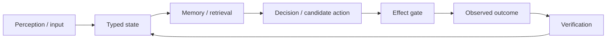

# Project Frankenstein — what this repository is trying to build

**Project provenance:** iar.frank.ink  
**Lead researcher / developer:** Gabriel Gschaider  
**Institute director / developer:** Dr. Andreas Unterweger

This page is for a technically curious human who does **not** want to scan the repository.
It is intentionally short, cumulative, and conservative about what has actually been proven.

## The idea in one sentence

Project Frankenstein is an engineering research program for building a useful software agent whose behavior can be traced through a repeatable loop:

The important part is not that a model can produce impressive text. The important part is whether an input can become a typed state, whether relevant evidence can be recovered, whether a decision has provenance, whether a real effect is gated and journaled, and whether the result is observed again instead of merely assumed.

## What exists, and what is still research

The repository contains several generations of the project. Historical names such as **Frank**, **ClayVerse**, **Mini Entity**, **Xeno** and **XCU** are part of that lineage. Under the current project authority, the product identity is **EntityOS** and the integrated cognition/compute architecture is **HCU**. Historical code remains useful as evidence and as a donor of mechanisms; it does not automatically define the current architecture.

The current research direction combines:

- a deterministic state/evidence substrate;
- a typed entry path for new information;
- memory and retrieval over stored evidence;
- an HCU compute plane with GRID-style logical cells;
- an experimental Global J-Space / workspace interface;
- explicit candidate generation, arbitration, effect gating and effect journaling;
- feedback from observed outcomes into later state and decisions.

This is **not** a claim that the system is conscious, sentient or subjectively aware. Terms inspired by cognitive science are used as engineering hypotheses and architectural metaphors unless a concrete software behavior is measured.

## UnifiedDB: one authority surface, not one giant blob

The project moved away from fragmented state spread across many unrelated stores toward a canonical SQLite-based substrate commonly referred to as **UnifiedDB** (or compatibility MiniUnifiedDB in older paths).

That does **not** mean “put every byte in one table.” A coherent authority substrate can still contain many typed tables, indexes, views, journals, writers and readers. High-rate transient sensor data may remain in RAM. Rebuildable projections may exist outside the canonical store. The goal is to reduce ambiguous ownership of facts, not to erase useful structure.

## Emergent Retrieval

**Emergent Retrieval** is the project term for relevance that appears when several independently stored evidence dimensions overlap at query time.

A result can become relevant because semantic similarity, time, causal lineage, current state, goals, perception, effect history, confidence and provenance point toward the same evidence. Nothing “appears from nowhere”; the retrieval emerges from intersections among evidence that was already stored.

## Self-reflection, without the mysticism

Here, self-reflection is an engineering control operation:

1. inspect current state and the last outcome;
2. detect a mismatch or failure;
3. generate a bounded correction candidate;
4. store or retrieve the correction with provenance;
5. alter later behavior;
6. **exit** reflection into `ACT`, `ASK`, `WAIT`, re-observation or another measurable state transition.

A reflection loop that only produces more reflection is a failure mode, not intelligence.

## Why negative results are kept

This project deliberately preserves failed hypotheses and broken integrations because they explain why the architecture changed.

Examples from the current lineage include:

- external model suggestions that looked plausible but were falsified by measurement;
- provider/fallback paths that continued running after a later authority epoch had disabled them;
- components that passed local tests but did not earn whole-system runtime credit;
- Free-Swarm / Forge / Distillery pipelines that produced very large raw token volumes while accepted training yield remained zero;
- latency, timeout, context-contamination and integration failures that forced changes in orchestration and state handling.

A failed experiment can be more useful than a green demo if it removes a bad architecture choice.

## A concrete recent example: thread-count tuning

A recent GRID10 experiment tested a plausible recommendation: use more PyTorch intra-op threads per process on a four-vCPU machine. With four concurrent model processes, the measured one-thread default was substantially faster than two threads, while four threads failed to complete samples within the experiment timeouts. The result supports the existing one-thread default for that measured topology and illustrates the project rule: **consultation creates a hypothesis; measurement decides.**

It does **not** prove that one thread is globally optimal on every machine or concurrency pattern.

## Perception, action, memory and training

**Perception** means admitting new information with type, provenance and causal identity before treating it as evidence.

**Action** means turning model or planner output into a candidate first. Real state-changing effects remain behind deterministic effect authority and a journal so that “requested” and “actually happened” are not conflated.

**Memory** means recoverable evidence with provenance, not a model pretending that it remembers something.

**Training** is downstream of evidence quality. A trained checkpoint is not automatically a successful result. The intended behavior must survive evaluation, lesion/control tests, lineage checks and off-target regression checks.

## The research question behind the architecture

One open hypothesis is that useful reflective agency requires a sufficiently rich external substrate of state, memory, perception, arbitration, effect receipts and verified outcome re-entry. The counter-hypothesis is that much of the apparent gain could come from prompt structure, logging correlation or ordinary workflow decomposition rather than from a distinct workspace/J-Space mechanism.

The project therefore treats workspace recurrence, model consensus and self-description as candidate signals — not as proof of causality.

## Where to go next

- For engineers and researchers: [`../DEV_SOURCE_RESEARCH/README.md`](../DEV_SOURCE_RESEARCH/README.md)
- For an AI tool that should enter without scanning the repository: [`../AI_START_HERE_DO_NOT_SCAN_REPO/README.md`](../AI_START_HERE_DO_NOT_SCAN_REPO/README.md)
- For the machine-readable Trigger-3 evidence map: [`../DEV_SOURCE_RESEARCH/repository/FRANKENSTEIN_EVIDENCE_INDEX_2026-08-27.json`](../DEV_SOURCE_RESEARCH/repository/FRANKENSTEIN_EVIDENCE_INDEX_2026-08-27.json)

## Evidence discipline used by this layer

Every important claim should be understood as one of: `CURRENT_SOURCE`, `HISTORICAL_SOURCE`, `PROJECT_MEASUREMENT`, `EXTERNAL_PRIMARY`, `INFERENCE`, `OPEN_HYPOTHESIS`, or `NEGATIVE_RESULT`.

The compact rule is:

> request ≠ effect · model output ≠ world fact · source-ready ≠ runtime-observed · repetition ≠ independent evidence
