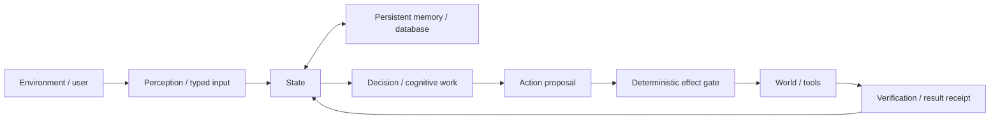

# Project Frankenstein — read this first

Project Frankenstein is the human-facing name for a long engineering lineage that is now converging into **EntityOS** with a **variable cognitive grid, persistent database, and Claude Code** as the strong model/tool partner.

**People and provenance**

- Lead researcher / developer: **Gabriel Gschaider**
- Institute director / developer: **Dr. Andreas Unterweger**
- Project provenance: **iar.frank.ink**

This page is intentionally short. It explains the machine without pretending unfinished research is finished.

## The loop

The important idea is not a personality. It is a loop that can **observe state, remember, decide, act, verify the result, and re-enter the verified result into the next state**.

A reflection step is useful only if it terminates into something measurable: **ACT, ASK, WAIT, re-observe, or another explicit state transition**. Recursive reflection without an exit is a failure mode, not intelligence.

## What is current

The current owner target is:

> **VARIABLE COGNITIVE GRID + PERSISTENT DATABASE + CLAUDE CODE**

`N` is a runtime parameter. GRID10 is an important benchmark configuration and historical engineering surface, but it is **not** the final architecture identity.

The small-model grid is intended to reproduce/distribute the cognitive functions that historically lived across Zero / EntityOS machinery: interpretation, relevance selection, planning, alternatives, uncertainty, workspace broadcast, memory proposals, recovery, and related control functions. Durable exact state belongs in the database when deterministic storage is better than repeatedly simulating it.

Rule of thumb:

> **SIMULATE COGNITION; STORE DURABLE DATA.**

Claude Code remains the strong model/tool/code partner. The grid is not meant to turn small models into Claude Code; it is meant to supply the persistent cognitive machinery around the strong model.

## UnifiedDB and Emergent Retrieval

The project historically accumulated fragmented state across multiple stores and services. The convergence direction is one canonical SQLite substrate for durable state/evidence, with typed tables, indexes, views, journals and rebuildable projections rather than a single unstructured “god file.” High-rate transient sensor state can still live in RAM.

**Emergent Retrieval** is the project term for relevance that appears when independently stored evidence dimensions overlap at query time—for example semantic similarity + time + causal lineage + current state + goals + perception + effects + confidence + provenance.

It does **not** mean information appears from nowhere.

SQLite WAL is a useful systems primitive because readers and a writer can proceed concurrently on one host while retaining transaction boundaries; this is an implementation property, not a claim that SQLite itself supplies cognition. Primary reference: https://www.sqlite.org/wal.html

NVIDIA Unified Memory is used only as a systems-design analogy: reducing ownership/copy boundaries can make a compute substrate easier to operate over coherently. Hardware memory coherence is **not** database semantics. Primary reference: https://docs.nvidia.com/cuda/cuda-programming-guide/02-basics/understanding-memory.html

## Global workspace / J-Space

The project uses global-workspace ideas as an engineering hypothesis about coordination and broadcast, not as a claim of consciousness or sentience. Global Workspace Theory has a long cognitive-architecture lineage; see Baars (2005), DOI `10.1016/S0079-6123(05)50004-9`, and Dehaene & Changeux (2011), DOI `10.1016/j.neuron.2011.03.018`.

Project claims require project evidence. A coherent output, repeated label, model self-report, or workspace recurrence does not by itself prove a causal internal representation.

## What failed matters

Frankenstein is documented as a research lineage, so failures remain visible. Important classes include:

- rumination / fixation and reflection loops without an exit;
- context contamination and prompt-vs-weight conflict;
- latency, timeouts and integration failures;
- dead modules and stale authority surfaces;
- false confidence from model consensus;
- provider/rate-limit/auth failures misread as scientific evidence;
- source-ready components misreported as runtime-observed systems;
- training or component tests over-promoted into whole-product claims.

The architecture changed because these failures forced changes.

## Current authority warning — 2026-08-27

The current supervisor state is **9.13 HARD_OFF** for external provider routes. Together is forbidden and there are zero remaining paid training runs authorized by the current authority.

The newly added 72-hour Frankenstein Bauleiter/Bugfixer provider orchestration is therefore **quarantined / non-operative as currently written**. Its source and tests are research artifacts; they are not deployment authorization.

Read the exact current steering before operational work:

- `research_entity/claycode/autonomous/SUPERVISOR_INBOX.json`
- the steering file selected by that inbox
- `research_entity/global/OWNER_CORRECTION_ZERO_ENTITYOS_COGNITIVE_GRID_DB_CLAUDECODE_GLOBAL_JSPACE_2026-08-25.md`
- `research_entity/topic_packets/frankenstein-master-cognition-concept/CURRENT_AUTHORITY_OVERRIDE_20260827.md`

## Where to go next

- Human reader: stay in `HUMAN_READ_THIS/`.
- Developer / researcher: open `DEV_SOURCE_RESEARCH/README.md`.
- AI installing or adapting the project: open `AI_START_HERE_DO_NOT_SCAN_REPO/README.md` and **do not scan the repository root first**.

The repository contains history, donors, failed experiments, old names and compatibility paths. Current authority and exact executable evidence outrank narrative neatness.