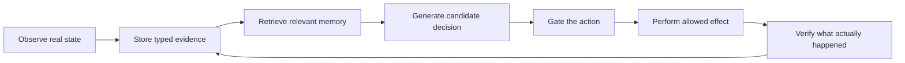
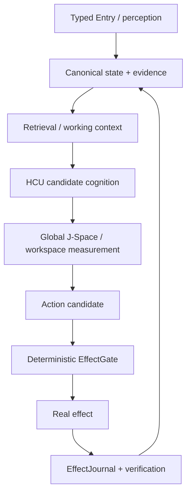

# Project Frankenstein — start here

Project provenance: **iar.frank.ink**  
Lead researcher/developer: **Gabriel Gschaider**  
Institute director/developer: **Dr. Andreas Unterweger**

This repository is a long-running engineering and research record. It contains working code, failed approaches, measurements, old names, experiments, control documents, and evidence receipts. That history is useful, but it also means the repository should not be read as if every file describes the current system.

## The simple idea

Frankenstein is an attempt to build a useful agentic computing system around a model instead of pretending that the model alone is the whole system.

A request is not an effect. A model answer is not a world fact. A remembered method is not an observation. The system must come back from an action and check the result.

## Why memory is outside the model

A language model is useful for generating and transforming representations, but it is a poor place to hide the only copy of system truth. Project Frankenstein therefore converged toward a canonical external state/evidence substrate, historically called **UnifiedDB** or its compatibility predecessor MiniUnifiedDB.

UnifiedDB is not a giant unstructured file. It is one authority substrate that can contain many typed tables, indexes, journals, policies, writers/readers, and rebuildable projections. Fast transient sensor state may still live in RAM. The point is coherent ownership, not putting everything into one blob.

The project term **Emergent Retrieval** means that relevance can appear when several independently stored evidence dimensions overlap at query time — semantic similarity, time, causal lineage, current state, goals, perception, effect history, confidence, and provenance. It does **not** mean information appears from nowhere.

## Reflection means control, not mysticism

Here, self-reflection is an engineering operation: inspect state and outcome, detect mismatch, generate a correction, preserve/retrieve it when useful, change later behavior, and then terminate into **ACT**, **ASK**, **WAIT**, re-observe, or another measurable transition.

A reflection loop that only produces more reflection is a bug, not deeper agency.

## Workspace, HCU and Global J-Space

The current research system is **EntityOS** with **HCU** as its integrated cognition/compute architecture. Global J-Space/GWT is treated as an empirical coordination/interface hypothesis: information may be made globally available to multiple functional processors, but textual coherence or model self-report does not prove hidden-state causality.

## Why the failures matter

The repository intentionally preserves negative results. They explain why the architecture changed: fragmented state ownership, rumination/fixation, context contamination, prompt-vs-weight conflicts, latency/timeouts, dead modules, integration failures, provider/rate-limit failures, and component successes that did not establish whole-system success.

One recent counterexample is especially useful: on a measured four-process/four-vCPU GRID10 topology, one torch thread per process was much faster than two, while four produced no completed samples within the experiment timeout. That supports one thread for that measured topology only; it is not a universal law.

## What is current and what is historical?

Current product identity: **EntityOS**.  
Current integrated compute/cognition architecture: **HCU**.

Names such as Frank, ClayVerse, Mini Entity, MicroEntity, Xeno and XCU remain important lineage, donor, or compatibility terms, but they are not separate current products or truth authorities.

Project Frankenstein is the reconstructed engineering/research lineage and agentic product framing around these mechanisms. No current architecture claim depends on consciousness, sentience, subjective experience, or old bio-inspired naming.

## Read next

- `../DEV_SOURCE_RESEARCH/README.md` — technical evidence map, current authority boundaries, failures, source paths, and research anchors.
- `../DEV_SOURCE_RESEARCH/FRANKENSTEIN_EVIDENCE_INDEX.json` — machine-readable evidence/lineage index.
- `../AI_START_HERE_DO_NOT_SCAN_REPO/README.md` — minimal capability-first instructions for an AI/tool host. Do not scan the whole repository first.
- `../research_entity/topic_packets/frankenstein-master-cognition-concept/CONCEPT.md` — Frankenstein cognition concept packet. Treat it as research/source material, not automatic runtime proof.

The repository is large because the research was real enough to make mistakes. The useful part is not hiding those mistakes; it is making the causal lineage legible.
