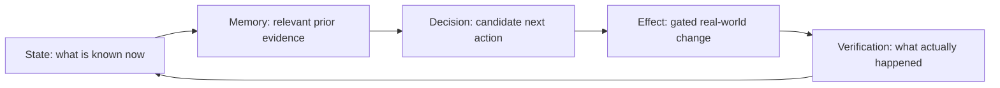

# Project Frankenstein — human entry

Project Frankenstein is the human-facing name for a long-running research and engineering line inside the Clay research entity. The current repository authority still names **EntityOS** as the product/system and **HCU** as the integrated cognition/compute architecture; Frankenstein material is therefore presented here as a research/build lineage, not as a second state authority or competing product.

**People and provenance**

- Gabriel Gschaider — lead researcher/developer
- Dr. Andreas Unterweger — institute director/developer
- project provenance: `iar.frank.ink`

## The short version

Frankenstein is trying to make an AI system useful over time by giving cognition something sturdier than a single prompt: explicit state, durable memory, observable perception, bounded decision machinery, journaled effects, and verified outcome re-entry.

The central loop is:

The important word is **verified**. A request is not an effect. Model output is not a world fact. A method existing is not the same as a result existing.

## What the project is actually building

### 1. State and UnifiedDB

The historical architecture accumulated multiple stores and services. That fragmentation made ownership, replay, causality, and recovery harder. The current design direction collapses canonical durable state/evidence toward one SQLite-based authority substrate (UnifiedDB, or the current compatibility state substrate where migration is incomplete), while allowing transient high-rate sensor state to remain in RAM.

A single authority substrate does **not** mean a single giant table or file with no structure. It can contain typed tables, indexes, views, writers/readers, journals, policies, and rebuildable projections.

### 2. Emergent Retrieval

`Emergent Retrieval` is the project term for relevance that appears when independently stored evidence dimensions overlap at query time: semantic similarity, time, causal lineage, current state, goals, perception, effects, confidence, provenance, and related signals.

It does **not** mean information appears from nowhere. It means relevance emerges from intersections among evidence already present.

### 3. Reflection that has an exit

Self-reflection is treated as an engineering control operation, not a claim about consciousness. A useful reflection cycle must inspect state/outcome, detect mismatch, propose correction, store or retrieve the correction, and then terminate into a measurable transition such as:

- `ACT`
- `ASK`
- `WAIT`
- re-observe
- another bounded state transition

Recursive reflection without an exit is a failure mode, not intelligence.

### 4. Perception, action and effect verification

Perception enters through typed admission. Cognition produces candidates. Real state-changing effects remain behind deterministic effect authority and journaling. External outcomes that are unknown remain unknown until verified; they are never silently replayed because a session or transport failed.

### 5. Workspace / GWT / J-Space research

The project investigates Global-Workspace-like coordination and a Global J-Space/vector-control interface as engineering hypotheses. These ideas are useful only if they produce model-specific, falsifiable causal evidence. Coherent text, recurring labels, model self-report, or majority agreement do not establish hidden-state causality.

### 6. GRF, Hyperposition and unresolved alternatives

GRF and Hyperposition belong to the research lineage for representing competing interpretations and regulating transitions. Hyperposition means unresolved alternatives can remain unresolved until evidence discriminates between them. Majority vote does not mint truth.

## What is real today, and what is not

The repository contains real GRID10/Fabric code, SQLite/WAL coordination, task/lease/regulator machinery, tests, runtime diagnostics, Frankenstein package/orchestrator/bugfix source, and a substantial evidence archive. The latest Frankenstein master concept itself explicitly distinguishes built mechanisms from aspirational additions such as permanent boot-time operation, physical sensors, and a web UI.

The newest supervisor state at the base commit of this curation (`854f6bc87780f4a5242489a6c807d186b16a8c3d`) also records a critical restriction: the current provider authority is **HARD_OFF**. The 72-hour Bauleiter/Bugfix orchestration is therefore **quarantined/non-operative** while it directly invokes NVIDIA/Groq/Mistral fallback routes or treats Together as available. Source existing and local tests passing do not grant execution authority.

## Why negative results stay visible

The project keeps failures because they explain the architecture:

- prompt/context contamination can overpower intended state control;
- prompt-vs-weight conflicts can make a model answer the label rather than the latent state;
- rumination/fixation can turn reflection into a loop with no action;
- latency and thread oversubscription can make apparently “more parallel” settings slower;
- integration and provider-boundary failures can invalidate otherwise good local code;
- source-ready code can still lack runtime acceptance;
- a component PASS can coexist with whole-product credit = 0.

A useful research history is not a victory montage. It is a chain of constraints that forced the next engineering move.

## A practical definition of agency for this project

The target is maximum practical agency inside a human-useful operating envelope: persistent state, memory, perception, arbitration, bounded reflection, effect receipts, and outcome verification. No present architecture claim requires consciousness, sentience, subjective experience, or historical bio-inspired names to be true.

## Where to go next

- Technical/research map: [`../DEV_SOURCE_RESEARCH/README.md`](../DEV_SOURCE_RESEARCH/README.md)
- Evidence/status map: [`../DEV_SOURCE_RESEARCH/research/FRANKENSTEIN_EVIDENCE_MAP.md`](../DEV_SOURCE_RESEARCH/research/FRANKENSTEIN_EVIDENCE_MAP.md)
- AI installer / no-root-scan entry: [`../AI_START_HERE_DO_NOT_SCAN_REPO/README.md`](../AI_START_HERE_DO_NOT_SCAN_REPO/README.md)

This layer is intentionally short. The repository below it is not.