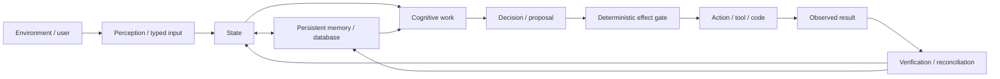
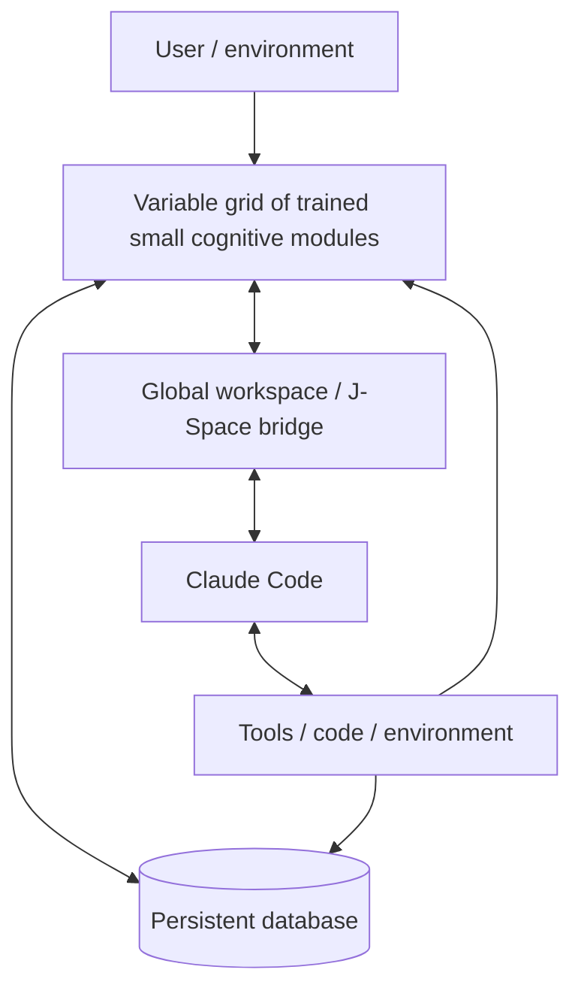

# Project Frankenstein — the human entry point

**Status:** current curation layer, evidence-bounded, not a release claim  
**Project provenance:** `iar.frank.ink`  
**Lead researcher / developer:** Gabriel Gschaider  
**Institute director / developer:** Dr. Andreas Unterweger

Project Frankenstein is a long-running attempt to build useful, persistent, adaptive agentic software without pretending that a language model is the whole system.

The name survived several architectural generations. The current product name is **EntityOS**. The current cognition/compute architecture is **HCU**. The current owner target is not a fixed ten-agent swarm: it is a **variable-size cognitive grid + persistent database + Claude Code**, connected through a global-workspace / J-Space bridge only as deeply as the exposed interfaces can actually support.

This page is deliberately short. It explains what the project is trying to do, what has actually been measured, and where the deeper evidence lives.

---

## 1. The central loop

Frankenstein is easiest to understand as a loop rather than as a chatbot.



In plain English:

1. **Observe something.** Do not silently convert a guess into a fact.
2. **Place it into typed state.** Preserve where it came from and which event it belongs to.
3. **Retrieve relevant memory.** Retrieval is a candidate-selection operation, not truth creation.
4. **Think.** The cognitive layer may plan, compare alternatives, simulate, critique and compress.
5. **Propose an action.** Model output is still only a proposal.
6. **Gate the real effect deterministically.** A proposal does not execute itself.
7. **Observe what happened.** A request is not the same thing as a successful effect.
8. **Re-enter the result.** The next decision should depend on measured outcome, not on the system remembering what it hoped would happen.

That loop — **state -> memory -> decision -> effect -> verification -> state** — is the durable idea behind much of the historical Frank, Zero and current EntityOS work.

---

## 2. What the finished machine is currently supposed to be

The highest-precedence current owner target in the research repository states:

> **VARIABLE COGNITIVE GRID + PERSISTENT DATABASE + CLAUDE CODE**

The module count `N` is a runtime parameter. Ten modules are useful as a benchmark and debugging configuration, but **GRID10 is not the final architecture identity**.

The intended division of labor is:



The small modules are intended to reproduce and distribute cognitive processes such as context interpretation, relevance selection, planning, alternatives, uncertainty, memory update proposals, critique, recovery and workspace competition. **They are not intended to replace Claude Code with a pile of tiny chatbots.** Claude Code remains the strong model/tool/code partner in the current owner target.

Durable exact data belongs in the database. The project rule is:

> **SIMULATE COGNITION; STORE DURABLE DATA.**

---

## 3. UnifiedDB: one authority substrate, not one giant table

Historical Frank/Zero work accumulated state across several services and databases. The UnifiedDB direction collapses *authority ownership* toward one deterministic SQLite substrate while still allowing many typed tables, indexes, views, readers, writers, policies and rebuildable projections.

That does **not** mean:

- every sensor sample must be synchronously written to one table;
- every derived graph becomes canonical truth;
- every index must be available before the canonical database can open;
- one database file magically solves provenance, recovery or causal identity.

In fact, the UnifiedDB research reproduced six architecture gaps on an accepted target. Among them: live schema could diverge from its source certificate; a derived graph could become an accidental availability dependency of canonical authority; stale projections could still be read; mixed time encodings could create false-current records; snapshot hashes could describe different logical instants; and unrelated Git changes could invalidate state when authority was bound too broadly.

Those are useful negative results. They forced the design toward **separate proof surfaces**: storage, executable migrations, live schema, semantic root, derived projections, replay clock, query/selection identity, immutable snapshots, minimal semantic dependencies, effect history and recovery.

A green component is therefore not automatically a green product.

---

## 4. Emergent Retrieval

**Emergent Retrieval** is a project term. It does not mean information appears from nowhere.

It means relevance can become strong only when several independently stored dimensions overlap at query time, for example:

- semantic similarity;
- time;
- causal lineage;
- current state;
- active goals;
- perception;
- earlier effects and outcomes;
- confidence / uncertainty;
- provenance;
- graph neighborhood;
- explicit filters and authority boundaries.

A record that is mediocre on each isolated dimension can become the best candidate when several dimensions agree.

The important boundary is this:

> Retrieval selects evidence. Retrieval does not manufacture evidence.

The deeper UnifiedDB work explicitly treats Graph, FTS, vector search, Hyperposition and other retrieval structures as candidate-producing mechanisms. Their outputs do not automatically upgrade truth authority.

---

## 5. Self-reflection, with an exit

The project does not need a metaphysical definition of introspection. **Self-reflection is an engineering control operation.**

A useful reflective cycle is:

```text
inspect current state / result
    -> detect a mismatch or uncertainty
    -> generate one or more correction candidates
    -> compare against evidence and constraints
    -> store/retrieve the correction when useful
    -> change the next transition
    -> EXIT INTO ACT / ASK / WAIT / RE-OBSERVE / another measurable state transition
```

The exit condition matters. A system that only reflects about its reflection is not becoming more agentic; it is becoming a very expensive decorative loop.

Historical and current project work therefore treats **rumination/fixation** as a failure mode. Useful reflection has to alter later behavior or deliberately terminate.

External agent research such as ReAct and Reflexion is useful as methodological context because it also studies interleaving reasoning/action and storing feedback for later trials. It is **external analogy**, not evidence that Frankenstein has reproduced those systems or that their results transfer automatically.

---

## 6. Global workspace and Global J-Space

Historical Frankenstein contained a `global_workspace.py` broadcast mechanism, and later EntityOS research developed a broader workspace/J-Space hypothesis.

The current project claim is deliberately narrower than some older language:

- workspace broadcast and typed re-entry can be engineered and measured;
- a model-specific activation intervention can be measured at an exact model/runtime/site identity;
- text coherence, recurring labels, model self-report or majority agreement do **not** establish hidden-state causality;
- Claude Code must only be claimed to expose the interfaces it actually exposes;
- deeper activation-level coupling to Claude Code remains a hypothesis unless an observable causal interface exists.

The current goal is therefore a **Global J-Space bridge at the strongest supported interface**, which may be typed ClayCode packets, shared-state slices, semantic Hyperposition, compressed workspace state, embeddings/vectors, or model-internal controls where those controls are genuinely accessible and causally evidenced.

---

## 7. GRF, Hyperposition, ClayCode and the cognitive language line

Several research strands attempt to make cognitive state more explicit and machine-operable instead of repeatedly serializing everything into prose:

- **GRF**: a project mathematical/engineering lineage for structured state/relation transforms;
- **Hyperposition**: preserving unresolved alternatives instead of collapsing uncertainty into a premature answer;
- **HyperMath**: compact mathematical state/transform work connected to that lineage;
- **ClayCode**: an internal language / IR direction for typed cognitive and system transitions.

The repository contains proof-carrying IR experiments and HyperMath/GRF fusion artifacts. These are research and implementation lineages, not permission to state that a particular trained small model already implements the full language internally.

---

## 8. Perception, action and memory

### Perception

Historical Frankenstein explored multiple visual paths, including adaptive routing, FrankEye, OCR/CNN/DINO-style processing and later native multimodal work. The archive records supersession relationships instead of pretending all historical backends remain current.

### Action

A model response is not an effect receipt. Current EntityOS architecture keeps real state-changing effects behind deterministic effect authority. Unknown external outcomes remain unknown until reconciled; blind replay is unsafe.

### Memory

Memory is not a transcript dump. The project has explored episodic records, causal chains, graphs, retrieval, forgetting, snapshots, derived indexes, state roots and persistent SQLite state. The current direction keeps canonical durable state deterministic and treats model-generated summaries/projections as derived unless explicitly admitted.

---

## 9. Training: what is being attempted

Historical Frankenstein contains LoRA/IAPT/SOMA training work and before/after probes. Current work targets a **Qwen3.5-0.8B-class cognitive module** for the variable grid.

The desired module is not trained to imitate a personality. It is intended to learn reusable cognitive-process behavior such as:

- process/state interpretation;
- DB-vs-simulation decisions;
- planning and replanning;
- uncertainty and alternatives;
- semantic Hyperposition;
- compact ClayCode-native protocol behavior;
- variable-`N` coordination;
- compression/state transfer;
- Claude Code handoff and return;
- workspace broadcast/uptake/re-entry;
- failure/restart/rejoin;
- hard negatives for stale state, false memory, hallucinated authority and majority-as-truth.

Training execution and training *readiness* are different things. Current product/training promotion remains blocked until the required evidence gates are actually passed.

---

## 10. Negative results are part of the architecture

Some of the most important project results are failures:

- historical/current database continuity tests exposed deeper proof-surface gaps beneath otherwise green components;
- FreeSwarm generated large token volumes while Forge/Distillery conversion remained the bottleneck;
- internal vector transport/actuation did not automatically establish abstract semantic behavioral control;
- nuisance controls and prompt/codebook leakage showed that a seemingly balanced benchmark can still be shortcut-solvable;
- provider/runtime authority drift demonstrated that a source path can keep making calls after higher authority has switched the route off;
- recent Frankenstein Bauleiter/Bugfix provider orchestration source was written and unit-tested, then **quarantined under current 9.13 HARD_OFF provider authority** rather than being advertised as a deployable autonomous runtime.

A failed hypothesis that changes the design is useful research. Deleting the failure would make the surviving architecture harder to understand.

---

## 11. No consciousness claim is required

Historical files use names such as `consciousness_daemon.py`, and the archive intentionally preserves them as provenance.

The present engineering case does **not** depend on consciousness, sentience or subjective experience. Global-workspace theory can be a design analogy; homeostasis can inspire regulators; reflection can be a control loop. None of those analogies establishes subjective experience in software.

The practical target is **maximum useful agency inside a human-useful operating envelope**, with measurable state, memory, uncertainty, effects, recovery and outcome re-entry.

---

## 12. Where to go next

For the technical research map, evidence classes, source paths, chronology and current blockers, read:

- [`../DEV_SOURCE_RESEARCH/README.md`](../DEV_SOURCE_RESEARCH/README.md)
- [`../DEV_SOURCE_RESEARCH/research/FRANKENSTEIN_RESEARCH_CHRONICLE.md`](../DEV_SOURCE_RESEARCH/research/FRANKENSTEIN_RESEARCH_CHRONICLE.md)
- [`../DEV_SOURCE_RESEARCH/repository/CURRENT_AUTHORITY_AND_EVIDENCE.md`](../DEV_SOURCE_RESEARCH/repository/CURRENT_AUTHORITY_AND_EVIDENCE.md)

For an AI/tool trying to work with the repository without scanning everything, read:

- [`../AI_START_HERE_DO_NOT_SCAN_REPO/README.md`](../AI_START_HERE_DO_NOT_SCAN_REPO/README.md)

The old root layout and older documentation remain in place for reproducibility. This curation layer does not erase them or silently reinterpret historical evidence.
