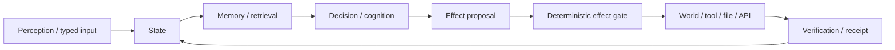

# Project Frankenstein — start here

Project provenance: **iar.frank.ink**  
Lead researcher/developer: **Gabriel Gschaider**  
Institute director/developer: **Dr. Andreas Unterweger**

This is the short human entrance to a large research repository. It intentionally does not pretend that every experiment worked, that every old name is still current, or that a model saying something makes it true.

## What the project is trying to build

The long-running engineering question is simple to state and hard to implement:

> How much practical agency can a language-model-based system gain when the important parts of cognition are moved out of a single prompt and into a measured, persistent, inspectable operating substrate?

The current product identity is **EntityOS**. The current integrated cognition/compute architecture is **HCU**. Historical names such as Frank, Frankenstein, ClayVerse, Mini Entity, MicroEntity and Xeno remain useful for reconstructing how the system evolved, but they are not automatically current product authorities.

“Project Frankenstein” is used here as the research lineage: many individually imperfect organs were built, measured, discarded, repaired and recombined. The joke is obvious. The engineering rule is less theatrical: a part only earns a place when its behavior and evidence justify it.

## The core loop

The project increasingly treats this loop as the actual machine.

- **Perception** brings observations into a typed entry path.
- **State** says what the system currently knows, believes, has measured, or still marks unknown.
- **Memory** retrieves relevant prior evidence and prior corrections.
- **Decision/cognition** proposes what to do next. Model outputs remain candidates, not truth.
- **Effect** is a request to change something outside cognition.
- **Verification** checks what actually happened and feeds the observed result back into state.

A request is not an effect. A model answer is not a world fact. A method existing in code is not proof that its result happened.

## UnifiedDB: one authority substrate, not one giant blob

A major historical engineering pressure was state fragmentation. Separate databases, side ledgers, caches and service-local memories make it easy for two parts of a system to disagree about what is current. The project therefore converged toward **UnifiedDB** / its current compatibility substrate: one deterministic authority for durable state and evidence, with many typed tables, indexes, views and journals inside it.

That does **not** mean “put everything in one file and hope.” High-rate transient sensor state can stay in RAM. Derived graphs can be rebuilt. Model activations and simulations can remain noncanonical. The point is to reduce competing ownership of durable truth.

SQLite is a practical fit because transaction boundaries, deterministic inspection and WAL-based concurrency are easy to test and reproduce. SQLite’s own documentation describes WAL as a mode where changes are appended to a write-ahead log and later checkpointed into the main database; that mechanism is useful infrastructure, not a claim that SQLite itself provides the project’s semantics.

## Emergent Retrieval

**Emergent Retrieval** is a project term for relevance that appears when independently stored evidence dimensions overlap at query time.

A useful memory item may become relevant because several weak signals agree:

- semantic similarity;
- recency or temporal proximity;
- causal lineage;
- current goals;
- current state;
- perception context;
- previous effects and outcomes;
- confidence and evidence status;
- provenance.

Nothing appears from nowhere. The “emergence” is in the intersection of signals that were stored independently and only become jointly informative for the present query.

## Reflection, with an exit

Self-reflection is treated as an engineering control operation, not as a claim of consciousness.

A reflective cycle is useful when it does four things:

1. inspects state and the observed outcome;
2. detects a mismatch or failure;
3. generates and stores a correction;
4. changes later behavior.

The critical extra rule is **termination**. Reflection must eventually produce one of a small set of measurable transitions: **ACT, ASK, WAIT, re-observe, or another explicitly bounded state transition**. Recursive reflection without an exit is rumination, not agency.

This direction is consistent with external language-agent research such as ReAct and Reflexion, which study interleaving reasoning with actions and using outcome feedback/episodic reflection to alter later decisions. Those papers are methodological analogies; they do not prove that Project Frankenstein’s implementation works.

## Global workspace, HCU and J-Space

The project borrows the engineering idea of a **global workspace**: specialized processes can operate in parallel, while selected information is broadcast into a shared workspace so multiple processes can use it. Neuroscience work on Global Neuronal Workspace is an external inspiration for broadcast/integration experiments, not evidence that this software is conscious or neurologically equivalent.

In current architecture:

- **HCU** is the integrated cognition/compute architecture;
- logical cells/modules can run request-scoped work;
- a shared workspace can broadcast selected state;
- **Global J-Space** is the hypothesis that a vector/representation-level interface can become a causal coordination surface between modules and models;
- Hyperposition preserves unresolved alternatives instead of forcing early consensus.

A recurring result across this research is that coherent text, majority agreement, recurrence or a pretty vector plot are not enough to establish causality. J-Space claims require model- and runtime-specific interventions, controls, lesions/shuffles/rescues where appropriate, and behavior that changes in the predicted direction.

## GRF and Hyperposition

**GRF** is part of the project’s historical mathematical/control lineage. It has been used to describe field-like aggregation, salience, resonance and coupling ideas that later fed into ClayCode/HyperMath/Hyperposition work.

The important current distinction is evidence level:

- mathematical forms and source implementations can be real;
- component tests can pass;
- a physical/multi-process GRID or model intervention can still remain unverified;
- therefore the broader architecture claim stays open.

Hyperposition is the complementary rule that competing hypotheses/candidates can remain represented simultaneously until evidence justifies a collapse. Majority vote does not mint truth.

## Why the project keeps negative results

Negative results are architecture.

Several major moves only make sense if the failures remain visible:

- fragmented state encouraged consolidation toward UnifiedDB;
- rumination/fixation made reflection-with-exit a hard requirement;
- prompt contamination and prompt-vs-weight conflicts motivated more explicit state/protocol channels;
- latency and timeout failures forced smaller bounded work packages and better backpressure;
- integration failures exposed cases where a component PASS did not survive the full path;
- vector transport sometimes changed internal state without producing the intended abstract behavioral control;
- FreeSwarm produced very large token volumes while accepted Distillery dataset tokens remained zero;
- provider-backed automation continued after a HARD_OFF authority change, exposing a real caller-boundary failure;
- a 2026-08-27 GRID10 thread-count A/B showed that a plausible optimization (more intra-op threads per process) made the measured 4-process/4-vCPU topology much slower.

Keeping these results is not pessimism. It is how the repository explains why the architecture looks the way it does.

## What is currently real, and what is not

The safest reading rule is:

| Label | Meaning |
|---|---|
| `CURRENT_SOURCE` | present in current source at the referenced identity |
| `HISTORICAL_SOURCE` | real older source/provenance, not automatically current |
| `PROJECT_MEASUREMENT` | measured project result at a bounded identity/scope |
| `EXTERNAL_PRIMARY` | external paper/spec/provider documentation |
| `INFERENCE` | conclusion from evidence, not directly measured |
| `OPEN_HYPOTHESIS` | testable idea still awaiting decisive evidence |
| `NEGATIVE_RESULT` | observed failure/counterevidence/blocker |

At the current 2026-08-27 authority epoch, whole EntityOS/HCU runtime credit, full HCU credit, canonical semantics promotion and training credit remain **zero**. That statement is deliberately stronger than “many parts work.” Several parts do work; the integrated claim has not earned promotion.

## Current Frankenstein authority warning

A new Bauleiter/Bugfixer orchestration was committed on 2026-08-27 with direct NVIDIA/Groq/Mistral fallback paths. The current supervisor authority is simultaneously **FREE_ONLY HARD_OFF for all external provider routes**, with Together forbidden and no paid fallback. The orchestration therefore remains **non-operative under current authority** until its caller boundary is gated before secrets/provider imports/network/Aider dispatch.

This contradiction is kept visible because it is exactly the kind of failure the evidence discipline is designed to catch.

## Training

The current research target is a small (~0.8B-class) cognitive module trained to understand the project’s cognitive process/state/protocol language, not a personality and not a second truth store.

The hardest training problem is not “make it answer better.” It is dynamic binding: the model must learn semantic relations and then bind them to episode-local symbols, process variables, state slots and tool/runtime interfaces without memorizing fixed label mappings or training-set nuisances.

External 2025 work on Transformer variable binding is useful here because it demonstrates, in a controlled symbolic setting, that systematic binding mechanisms can emerge after earlier heuristic phases and can be investigated with causal interventions. That is a method precedent, not Qwen-specific evidence for this project.

Training is not PASS merely because a job finishes. Promotion requires retained protocol/logic behavior, target behavior, frozen evaluations, ancestry/provenance controls, hard negatives, and model-specific causal evidence where the claim is causal.

## Where to go next

For technical reconstruction, open:

- `DEV_SOURCE_RESEARCH/README.md`
- `DEV_SOURCE_RESEARCH/research/FRANKENSTEIN_RESEARCH_CHRONICLE.md`
- `DEV_SOURCE_RESEARCH/research/EVIDENCE_MAP.json`

For an AI/tool trying to install or inspect the project without scanning the entire repository, open:

- `AI_START_HERE_DO_NOT_SCAN_REPO/INSTALL.md`
- `AI_START_HERE_DO_NOT_SCAN_REPO/INSTALL_CONTRACT.json`

Those layers are designed to make the repository progressively disclosive: human explanation first, exact source and evidence deeper, machine installation instructions shortest of all.
