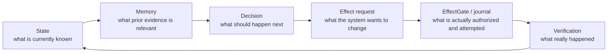

# Project Frankenstein — Start Here

Project Frankenstein is a long-running engineering and research effort about **practical machine agency**: how a system can keep useful state, remember what matters, notice changes, choose an action, execute it through a controlled effect path, and then verify what actually happened.

The project provenance is **iar.frank.ink**. **Gabriel Gschaider** is lead researcher/developer; **Dr. Andreas Unterweger** is institute director/developer.

This page is intentionally short. It describes the engineering idea without pretending that every historical concept is a current capability.

## The loop

The important word is **verification**. A model saying that something happened is not evidence that it happened. A request is not an effect. A plan is not execution. A passing component test is not a whole-system pass.

## Why the architecture changed

Early Frankenstein work explored many separate services and stores for memory, perception, goals, reward, reflection, tools, experiments, and workspace-style coordination. The historical Project-Frankenstein archive records runtime source for pieces such as a global workspace, thalamic/sensory gating, project and hypothesis engines, memory/claim/graph retrieval, LoRA training, visual pipelines, and persistent state. The accessible Git scope currently frozen for Level-0 historical reconstruction begins at commit `e1a8812767668091d146ee958bbc2ebb2743031c` and runs through frozen head `abba90a5767d85abc8a1ac340bae92842dab35c1`, an explicitly bounded 545-commit obligation. This is a reconstruction boundary, not a claim that all 545 commits have already been semantically reconstructed.

Over time the project moved toward fewer competing authorities. The current research program calls the product **EntityOS** and the integrated cognition/compute architecture **HCU**. Historical names such as Frank, ClayVerse, Xeno, and XCU remain useful provenance, but they are not separate current products.

## UnifiedDB: one authority substrate, not one giant table

The project converged away from fragmented state toward a canonical SQLite-based substrate. “Unified” means **one place where durable authority and evidence can be reconciled**, not “put everything in one god table.” A coherent substrate can contain many typed tables, indexes, views, journals, readers, writers, policies, and rebuildable projections. Very high-rate transient sensor state can still live in RAM when that is the correct engineering boundary.

SQLite/WAL is useful here because it supports transactional durability and concurrent readers while keeping the operational surface small. The project uses that as an engineering substrate; it does **not** claim that SQLite itself provides cognition.

## Emergent Retrieval

`Emergent Retrieval` is the project term for relevance that appears when independently stored evidence dimensions overlap at query time: semantic similarity, time, causal lineage, current state, goals, perception, effects, confidence, provenance, and related constraints.

Nothing appears from nowhere. The “emergent” part is the **ranking/assembly effect of multiple existing evidence dimensions**, not spontaneous information creation.

## Reflection must have an exit

Self-reflection is treated as a control operation, not a consciousness claim:

1. inspect state and outcome;
2. detect a mismatch;
3. generate a correction candidate;
4. store or retrieve the correction;
5. alter later behavior;
6. terminate into **ACT**, **ASK**, **WAIT**, re-observation, or another measurable transition.

A loop that only reflects about its own reflection is a failure mode, not deeper agency.

## Perception, action, memory, training

- **Perception** converts observations into typed evidence; it does not automatically make an interpretation true.
- **Action** is separated from model output by deterministic effect authority and journaling.
- **Memory** is evidence with provenance, not a substitute for observation.
- **Training** is useful only when the intended behavior is measured after training. “Training completed” is not a scientific pass.
- **Workspace / GWT / Global J-Space** ideas are treated as testable coordination hypotheses. The architecture does not depend on a claim of consciousness, sentience, or subjective experience.

## What is known, and what is not

| Claim | Evidence status |
|---|---|
| Project-Frankenstein historical source contains multiple working architectural modules | **HISTORICAL_SOURCE** |
| A 545-commit historical reconstruction scope was explicitly frozen for the accessible Project-Frankenstein lineage | **PROJECT_MEASUREMENT / SCOPE LAW** |
| Current product identity is EntityOS and integrated cognition/compute architecture is HCU | **CURRENT_SOURCE** |
| Current supervisor authority is 9.13 HARD_OFF for external providers | **CURRENT_SOURCE** |
| Fresh 2026-08-27 provider-backed Frankenstein orchestration code exists in source | **CURRENT_SOURCE** |
| That provider orchestration is currently authorized to run | **NEGATIVE_RESULT — NO** |
| Whole EntityOS/HCU has runtime acceptance | **NEGATIVE_RESULT — NO; credit remains 0** |
| Global J-Space causes improved cognition in the target model | **OPEN_HYPOTHESIS** |
| Useful reflective agency needs a rich external substrate of state, memory, perception, arbitration, effect receipts, and verified outcome re-entry | **OPEN_HYPOTHESIS** |

The newest supervisor evidence is especially important: the 72-hour Bauleiter/Bugfixer design that directly calls NVIDIA/Groq/Mistral and treats Together as available is **quarantined and non-operative** under current HARD_OFF authority. Source existence is preserved because negative and conflicting evidence is part of the research record.

## One systems analogy, carefully bounded

NVIDIA CUDA Unified Memory reduces explicit ownership/copy boundaries by letting CPU and GPU access managed memory through a coherent programming model. That is a useful **systems-design analogy** for reducing state ownership fragmentation. It is not database semantics, not evidence that UnifiedDB behaves like GPU memory, and not evidence for cognition.

## Where to go next

- Technical chronicle and evidence map: [`../DEV_SOURCE_RESEARCH/README.md`](../DEV_SOURCE_RESEARCH/README.md)
- AI/tool installation entry: [`../AI_START_HERE_DO_NOT_SCAN_REPO/INSTALL.md`](../AI_START_HERE_DO_NOT_SCAN_REPO/INSTALL.md)
- Historical Project-Frankenstein manifest: [`../research_entity/archive_assimilation/manifests/PROJECT_FRANKENSTEIN_MANIFEST.json`](../research_entity/archive_assimilation/manifests/PROJECT_FRANKENSTEIN_MANIFEST.json)
- Current authority inbox: [`../research_entity/claycode/autonomous/SUPERVISOR_INBOX.json`](../research_entity/claycode/autonomous/SUPERVISOR_INBOX.json)

## External primary references used as analogies/background

- Bernard J. Baars, *Global workspace theory of consciousness: toward a cognitive neuroscience of human experience*, Prog Brain Res. 2005. DOI: `10.1016/S0079-6123(05)50004-9`.
- SQLite official WAL documentation: `https://www.sqlite.org/wal.html`.
- NVIDIA CUDA Programming Guide, Unified Memory: `https://docs.nvidia.com/cuda/cuda-programming-guide/04-special-topics/unified-memory.html`.

These references provide external context only. They do not promote a project hypothesis into a project measurement.
