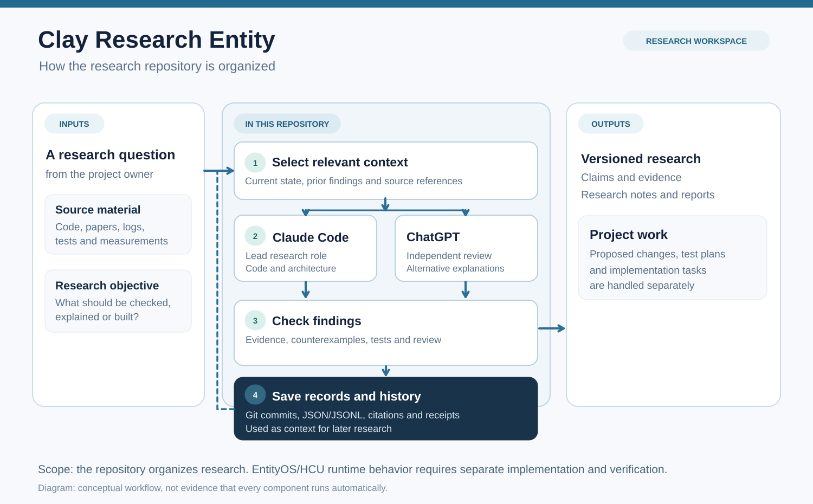

# Clay Research Entity

This repository stores and organizes research for the Frankenstein / OMEGA / EntityOS software projects. It includes research records, source material, experiments, scripts, test cases, project plans and coordination documents.

It is a **research workspace**, not the complete EntityOS application or a continuously running artificial intelligence system. A document, script or test in this repository is not evidence that a proposed system works in production.



*The diagram describes the repository's research process. Some activities depend on a person, a model session or an external execution environment.*

## Purpose

The repository is used to keep research work reproducible across sessions and tools. It provides a place to:

- Record questions, hypotheses, supporting evidence, contrary evidence and negative results.
- Identify the source and author of research materials.
- Retrieve previous findings before starting new work.
- Coordinate work performed by people and different AI model sessions.
- Store implementation proposals, tests and evidence of executed work.
- Keep an auditable history of changes through Git and structured records.

## How it works

1. **Define the task.** A person or a research session starts with a question, a bug, a proposed feature or an experiment.
2. **Load relevant context.** The researcher consults the current project state and the relevant records instead of treating every file in the repository as equally current.
3. **Examine the problem.** The research process can use Claude Code for lead research and ChatGPT for independent review. They are separate contributors, not separate persistent databases or authorities.
4. **Check the evidence.** Findings should be linked to sources, experiments, tests or other reproducible observations. Conflicting and negative results are retained.
5. **Record the result.** Structured records, documentation, source references and Git history preserve what changed and why. A model response by itself does not establish a verified fact.
6. **Apply results separately.** An accepted proposal may inform EntityOS or other project development, but real changes and execution require their own permissions, checks and verification.

## Repository structure

| Path | Contents |
| --- | --- |
| `research_entity/continuity/` | Research identity, versioned state and session bootstrap information. |
| `research_entity/ledgers/` and `research_entity/events/` | Claims, claim-status changes and research events. |
| `research_entity/provenance/` | Information about authorship, source origin and ingestion. |
| `research_entity/topic_packets/` and `research_entity/research/` | Topic-specific research material and analyses. |
| `rae.py` and `rae_core/` | Python command-line entry point and research utilities. |
| `tools/` | Supporting scripts for validation, source ingestion, retrieval and other tasks. |
| `tests/` and `benchmarks/` | Test cases and benchmarking material. |
| `governance/` | Execution boundaries, permissions and coordination rules. |
| `the artefact/` | Project workspace for EntityOS and its proposed HCU architecture. |
| `docs/` | Documentation and diagrams. |

The repository contains historical documents alongside current ones. File presence or a recent timestamp does not necessarily make a document authoritative. For current work, consult the existing authority and state-resolution documents.

## Research data and software

The repository combines several distinct kinds of material:

- **Versioned research records:** JSON and JSONL files describe research state, claims, events and provenance.
- **Source references:** Source material can be linked to research records and searched through supporting tools.
- **Derived search data:** The Python tools can build a local SQLite database for queries. A search index is a convenience, not a replacement for the underlying records.
- **Execution evidence:** Test outputs and receipts can document individual operations. Their scope must not be extended to untested systems.
- **Project implementation work:** Source code and engineering notes describe components under development. Their completion and operational status must be checked individually.

The project distinguishes observed behavior from design proposals. In particular, the presence of a cognition architecture, a model interface or a multi-agent workflow does not prove that the integrated system has been validated.

## Command-line entry point

The repository includes a Python command-line tool:

```bash
python3 rae.py --help
python3 rae.py status
python3 rae.py query "memory retrieval"
python3 rae.py doctor
```

These commands display available options, read research status, query indexed records and run local checks. `doctor` may rebuild local search data and invoke validation scripts; review the code and environment before running it.

Other operations include task-specific context preparation, research-run checkpoints, claim and event recording, provenance checks and benchmark execution. Use `python3 rae.py --help` for the implemented command syntax. Some operations write files and require an appropriate research actor identity.

## Relationship to EntityOS

**EntityOS** is the target software system. **HCU** is the name used in this project for its proposed integrated cognition and computation architecture. **Clay** is the persistent research identity represented by this repository. These terms refer to different roles.

This repository supports research and engineering around these systems. It does not replace the application runtime, grant access to a computer or authorize external actions merely because such mechanisms are described in its files.

## Starting points for contributors with access

- [Agent instructions](AGENTS.md) — current navigation and required checks.
- [Execution authority](CLAY_EXECUTION_AUTHORITY.md) — boundaries for permitted work.
- [Current-state entry point](000_CLAY_CURRENT.md) — navigation to selected current research files.
- [Research continuity](research_entity/continuity/BOOTSTRAP_MINIMAL.json) — structured bootstrap metadata.
- [Research provenance](research_entity/global/PROVENANCE_POLICY.md) — source and contributor attribution rules.
- [Project workspace](the%20artefact/README.md) — EntityOS/HCU implementation context.

## License and permitted use

**Proprietary source-available software; private, non-commercial use only.**

See [LICENSE](LICENSE). The repository is **not open source**. Public access to repository contents, if enabled, does not grant permission to redistribute, publish, sublicense, commercially use or incorporate the material into another distributed product. Any use beyond the limited permission in the license requires written authorization from the relevant copyright holder.

Third-party components retain their own applicable licenses.
