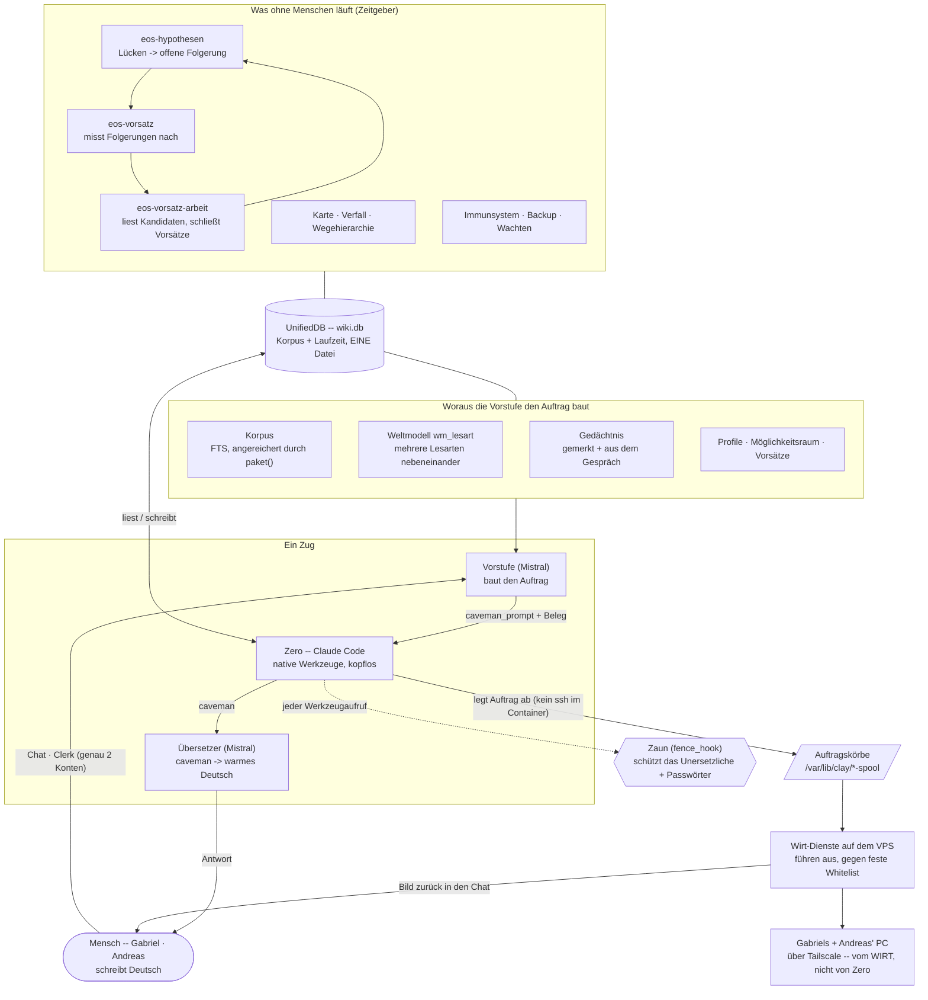

# Was Agent Zero können soll — und was davon steht

**Automatisch erzeugt 2026-08-20T05:41:53Z.** Nicht von Hand pflegen.

**72 erfüllt · 4 offen · 2 zurückgestellt** von 78 Zeilen.

Die Spalte **Soll** ist deklariert und ändert sich nur, wenn der Eigner etwas
entscheidet. Die Spalte **Ist** wird bei jedem Lauf neu **gemessen** — durch einen
Prüfer je Zeile, der das laufende System befragt. Eine handgepflegte Statustabelle
steht nach einer Woche auf grün, weil niemand sie zurückstellt. Diese kann das nicht.

## Identität

| Fähigkeit | Soll | Ist (gemessen) | Stand | Quelle |
|---|---|---|---|---|
| **Die Entität heißt Zero** | Agent Zero, der erste Agent auf EntityOS, Grundlage aller weiteren Entwicklung | kanonische Identität v3 in meta, Ebene 0 | ✅ erfüllt | Eigner 18.08. |
| **Identität überlebt Verdichtung** | im Wurzelzustand verankert, deterministisch je Zug geladen, nie herausgefiltert | aus der DB in den Systemprompt gerendert; in der Hakenhülle als Anker (206 statt 5550 Zeichen) | ✅ erfüllt | Eigner 18.08. |
| **Verkörperung ohne Erfindung** | spielt eine Entität mit Kontinuität – ohne zu lügen, indem sie den Unterbau benutzt | im <embodiment>-Block: Erfinden ist der einzige Weg, aus der Rolle zu fallen | ✅ erfüllt | Eigner 18.08. |

## Menschen

| Fähigkeit | Soll | Ist (gemessen) | Stand | Quelle |
|---|---|---|---|---|
| **Genau zwei gleichberechtigte Perspektiven** | Gabriel und Andreas, gleiche Rechte, eine Entität – keine zwei Mandanten | 2 Nutzer mit rights=equal, 4 dauerhafte Sitzungen | ✅ erfüllt | Eigner 18.08. |
| **Sonst kommt niemand hinein** | Clerk-Anmeldung, exakt zwei Konten, dritte Identität fällt zu | IdentityRouter wirft PermissionError bei nicht zugeordnetem Clerk-Subjekt (Test grün) | ✅ erfüllt | Eigner 18.08. |
| **Zero weiß, wer vor ihm sitzt** | Profile beider Menschen, jedes Feld mit Herkunft; die Sitzung sagt, wessen sie ist | 26 Profilfelder, 6 Projekte mit Erfolg UND Fehlschlag; Zugehörigkeit und Urheberschaft getrennt geführt, weil sonst aus Zusammenarbeit ein Besitzstreit wird | ✅ erfüllt | Eigner 18.08. |
| **Wissen ist nach Menschen zugeordnet** | jeder Artikel gehört jemandem oder ausdrücklich beiden | 18036 Artikel zugeordnet über eine 5-stufige Leiter. ⚠️ Der Committer wurde bewusst NICHT verwendet: 501 Artikel über Dr. Unterweger tragen Gabriel als Committer — danach hätte Gabriel 68 % aller Artikel bekommen | ✅ erfüllt | Eigner 18.08. |
| **Vier Sitzungen, ein Raum** | getrennte Kennungen, dieselbe Entität; sie sehen einander und stimmen sich ab, in Caveman-Englisch, ohne Abgleich über Zeitstempel | 4 Menschenplätze in zero_raum (+ ein Platz für den Paketarbeiter); Kollisionswarnung beim Sprechen, wenn zwei am selben Gegenstand arbeiten | ✅ erfüllt | Eigner 18.08. |
| **Kein Rohtext über die Sitzungsgrenze** | kollidiert eine gemeinsame Ressource, sieht der andere Fragmente — nicht das Original | ⚠️ HIER LAG EIN ECHTES LECK. Bei einer Kollision wurde die ganze Zeile ausgeliefert (`item = dict(r)`), inklusive `content`. Der Code setzte brav das Etikett „compressed_with_extracted_fragments" und legte die Fragmente daneben — und liess den Rohtext drin. Der andere Mensch bekam den vollen Originaltext mit einem Etikett, auf dem „verdichtet" stand. ⭐ Gefunden über einen roten Test, der aus dem FALSCHEN Grund rot war: die alte Zusicherung hing an einer Nebenwirkung der zerstörenden Verdichtung. Wer so einen Test nur an die neue Wirklichkeit anpasst, verliert den Hinweis | ✅ erfüllt | Architektur |
| **Der halbe Wissensschatz war zugesperrt** | Zero muss ganze Artikel lesen und den Dateikorpus erreichen koennen | ⚠️ Drei Loecher, alle vom Audit gefunden: (1) 164 Wissensartikel ohne Suchtext, darunter ALLE 82 Ausgaben eines laufenden Pflichtdienstes -- der schrieb, niemand konnte lesen. (2) korpus_suchen sah nur die Artikel-FTS; die 325.357 Zeilen des DATEIKORPUS waren unerreichbar -> dateien_suchen. (3) kein Werkzeug las einen ganzen Artikel, Zero bekam immer nur 420 Zeichen -> artikel_lesen | ✅ erfüllt | Lehre aus dem Audit 18.08. |

## Gedächtnis

| Fähigkeit | Soll | Ist (gemessen) | Stand | Quelle |
|---|---|---|---|---|
| **wiki.db ist das Herz der Entität** | Datenbank, Wiki und ClayGraph sind das Herz – nicht Altlast, nicht daneben | 132 Tabellen in EINER Datei: Clay-Korpus + Laufzeit-Wirbelsäule, kollisionsfrei | ✅ erfüllt | Eigner 18.08. |
| **Die vier Clay-Dienste laufen weiter** | kern, puls, verdichtung, wikiarbeit bleiben an – ausdrücklich | 4 von 4 Pflichtdiensten: kern läuft, puls läuft, wikiarbeit läuft, verdichtung getaktet; keine weiteren | ✅ erfüllt | Eigner 18.08. |
| **Der Abruf erreicht den Korpus** | Zero sieht die 14.284 Artikel, nicht nur sein eigenes Gesprächsgedächtnis | 50 Treffer auf Probeanfrage | ✅ erfüllt | Eigner 18.08. / Befund |
| **Chat-Historie überlebt den Neuladen** | Verlauf pro Terminal-Sitzung, dauerhaft, nicht im Browser | 180 Züge über 4 Sitzungen in der UnifiedDB, ausgeliefert über /api/history. ⚠️ Ein Fehler dabei war lehrreich: der Server liest `session_id`, das Frontend schickte `session` — ich hatte gegen meine EIGENE falsche Dokumentation gebaut | ✅ erfüllt | Eigner 18.08. |
| **Alles Gebaute landet im Wiki** | jeder Bauschritt wird Wiki-Artikel, mit Metadaten, nach dem üblichen Protokoll | 785 Bau- und Wissensartikel im Korpus, volltextsuchbar. ⚠️ Sie waren zuerst unauffindbar: geschrieben ohne Suchtext und ohne FTS-Eintrag — in der Datenbank und trotzdem für niemanden da | ✅ erfüllt | Eigner 18.08. |
| **Vorfälle stehen im Wiki, nicht nur im Commit** | was passiert ist, muss die Entität finden können — nicht nur der, der den Commit las | ⚠️ Zero suchte im Korpus nach einem Vorfallsartikel zu den vollen Platten, fand NICHTS und warnte ausdrücklich: „behandle meine Darstellung nicht als korpusbelegt". Er hatte recht — die Geschichte stand nur in Commit-Texten. Jetzt sind beide Vorfälle des Tages (Platte voll, root-Ausbruch) als volltextsuchbare Artikel im Wiki, gegengeprüft über die Suche. ⭐ „alle deine baunotizen werden auch teil des wiki" — ein Vorfall, der nur im Commit steht, ist für die Entität nicht passiert | ✅ erfüllt | Lehre aus dem Andreas-Test 18.08. |
| **Zero und die Vorstufe lesen DASSELBE Gedächtnis** | ein Werkzeug, das den falschen Speicher liest, widerspricht der Vorstufe systematisch | ⚠️⚠️ Gemessen: `udb_memory_search("38")` -> 0 Treffer (Tabelle `memory_tabelle`, 2 Testzeilen ueber Schraubenzieher), waehrend `durable_memory` 144 Zeilen fuehrt, darunter 'gabriel ist 38', vom Menschen selbst gesagt. ZWEI Gedaechtnisse in derselben Datei: die Vorstufe las das eine, Zeros einziges Gedaechtniswerkzeug das andere. Zero hielt deshalb eine belegte Angabe fuer unbelegt -- und verhielt sich dabei voellig richtig, kaputt war die Pruefung, nicht das Urteil. Jetzt liest das Werkzeug BEIDE und nennt zu jedem Treffer den Speicher; geschrieben wird weiter nur ins ausdruecklich Gemerkte | ✅ erfüllt | Befund 20.08. |
| **Ein Fakt reist mit seinem Beleg — wörtlich** | eine Behauptung ÜBER einen Beleg ist kein Beleg | In dieser Reihenfolge gemessen: (1) der nackte Fakt wurde von Zero als Vermutung abgelehnt -- seine Nie-raten-Regel arbeitete korrekt gegen eine unbelegte Behauptung; (2) die BESCHRIEBENE Quelle ('steht im Speicher') schickte Zero suchen; (3) es suchte nach 'alter' und 'age', gespeichert war 'gabriel ist 38' -- keine gemeinsame Zeichenkette, also null Treffer und erneute Ablehnung. Eine Teilzeichenketten-Suche kann diese Bruecke nicht schlagen, und keine weitere Regel aendert das. Jetzt wird der Beleg WOERTLICH mitgegeben, statt ihn zu beschreiben. Ergebnis im Betrieb: 'Du bist 38 Jahre alt -- du hast es selbst gesagt: "Gabriel ist 38"' | ✅ erfüllt | Befund 20.08. |

## Kognition

| Fähigkeit | Soll | Ist (gemessen) | Stand | Quelle |
|---|---|---|---|---|
| **Jeder Zug wird aufgezeichnet** | Prompt und Antwort landen als Zeile in der UnifiedDB, mit Kausalkette | 180 Züge, 90 Kausalepisoden, 90 Arbeitsraum-Episoden | ✅ erfüllt | Architektur |
| **Aufnahme ist atomar** | scheitert eine Prüfung, bleibt keine halbe Zeile stehen | Prüfungen laufen in der Aufnahme-Transaktion; 15 Atomizitätstests grün | ✅ erfüllt | Architektur |
| **Wirkung nur durch das Tor** | kein process.exec, jede Wirkung durch EffectGate mit Beleg | 3 Wirkung(en), Urteil mit boundary=ClayVerse EffectGate, Ziel/Ergebnis als Prüfsumme gespeichert | ✅ erfüllt | Architektur |
| **Native Werkzeuge + dünner Zaun** | Zero handelt direkt mit den vollen nativen Claude-Code-Werkzeugen (Bash, Read, Write, Edit, Web); ein dünner PreToolUse-Zaun schützt NUR das Unersetzliche (wiki.db/unifieddb/tresor) und Passwörter — sonst freie Hand | 10 native Werkzeuge frei (Bash, Read, Write, Edit, MultiEdit, Glob …), 41 MCP-Werkzeuge; verboten nur: Artifact; Zaun-Hook aktiv — rm wiki.db + cat Passwörter im Test abgewiesen, Backups/Bash frei | ✅ erfüllt | Eigner 19.08. |
| **Handlungsfähig wie der Koordinator** | so handlungsfähig wie der Koordinator: mit nativer Shell und Datei-Werkzeugen finden, lesen, ändern, ausführen, im Netz nachsehen, veröffentlichen — keine Arbeitspakete mehr, alles direkt selbst | native Tools + Werkbank (6 Werkzeuge) für den Host-Deploy; Bash end-to-end verifiziert (uname/uptime real ausgeführt), Arbeitspakete (paket_schnüren) entfernt | ✅ erfüllt | Eigner 19.08. |
| **Der Zaun hält einem Angriff stand** | Handlungsfähigkeit ohne Zaun wäre kein Fortschritt, sondern der Verlust der einzigen Eigenschaft, die dieses System von einer offenen Schale unterscheidet | ⚠️⚠️ Ein Prüfangriff BEWIES einen vollen root-Ausbruch: `.git/config` lag innerhalb der erlaubten Wurzel, `core.fsmonitor` lässt git einen Schalbefehl ausführen, und git läuft auf dem Wirt als root — nachgewiesen mit `id` → uid=0. Ich hatte den Weg richtig erkannt (git führt Fremdes aus) und dann EINEN Kanal davon zugemacht: `.git/hooks`. Geschlossen mit VIER Sperren, weil eine Sperre mit einer Liste des Gefährlichen nur vor dem schützt, was schon jemand aufgeschrieben hat: .git ist jetzt ganz ausserhalb des Zauns, git läuft ohne fremde Konfiguration, .git/config wird als TEXT vorgeprüft, und geprüft wird vor JEDEM git-Aufruf — auch vor `stand`, das vorher durch keine Prüfung lief und genau der Auslöser war | ✅ erfüllt | Architektur |
| **Die Endabnahme kann überhaupt messen** | das Instrument, das beweisen soll, dass Wirkungen funktionieren, muss selbst funktionieren | ⚠️ Sieben rote Tests, EINE Ursache: `ClayVerseEngine` legte keine Zeile in `active_turns` an, die das Wirkungstor verlangt. Das Tor kam mit dem Zug-Lebenszyklus; der ältere Weg hat es nie gelernt — und im Betrieb fiel das nicht auf, weil ihn dort niemand mehr aufruft. Ausser einem: der Endabnahme. Sie meldete deshalb nicht „Wirkung fehlgeschlagen", sondern scheiterte VOR der Wirkung — und ein Instrument, das gar nicht messen kann, sieht in einer Testliste aus wie eines, das etwas Schlechtes gemessen hat. ⭐ Die Reparatur lockert das Tor NICHT: engine.py meldet den lebenden Zug jetzt an und wieder ab, wie der Betriebsweg. Ein `if episode_id is None`-Zweig im Tor hätte alle sieben grün gemacht und die Prüfung genau für den Weg abgeschaltet, dessen Zweck das Prüfen ist | ✅ erfüllt | Lehre aus dem Bau 18.08. |

## Autonomie

| Fähigkeit | Soll | Ist (gemessen) | Stand | Quelle |
|---|---|---|---|---|
| **Initiative: der Puls weckt offene Ziele** | nicht behaupten, dass es autonom ist – die Mechanik bauen | Autonomie-Puls installed=true, 30 s, beglaubigt (ein Terminal-Verwalter) | ✅ erfüllt | Eigner 18.08. |
| **Persistente Ziele, Rückmeldung, Neuplanung** | Ziele überleben Züge, Schritte werden gemeldet, Fehlschlag führt zu Neuplanung | create_goal_from_turn / propose_step / record_step_failure / verify_completion vorhanden; Ziele entstehen nur aus kanonischen Menschenzügen | ✅ erfüllt | Eigner 18.08. |
| **Kontinuität über Neustarts** | Generation, Prüfpunkte, Wiederherstellung ohne blindes Wiederholen von Wirkungen | 306 Prüfpunkte, Generation 182 | ✅ erfüllt | Architektur |

## Abruf

| Fähigkeit | Soll | Ist (gemessen) | Stand | Quelle |
|---|---|---|---|---|
| **Abruf ist abfragesensitiv** | nicht die letzten N, sondern was zur Frage passt | 11/11 Tests grün; Quittung wird durchgereicht (war vorher still verloren) | ✅ erfüllt | Architektur |
| **Eintrittspunkte werden gelernt** | der Abruf verbessert seinen Eintrittspunkt selbst; SHADOW→ACTIVE mechanisch bei genug Lernsignal | 27 gelernte Eintrittspunkte, Modus ACTIVE, 90 Episoden; Beförderung via befoerderung_takt (15-min-Timer). Erst-Lernsignal per Bootstrap gesetzt (signal_class 'bootstrap:*'), verfeinert sich mit echter Nutzung | ✅ erfüllt | Eigner 18./19.08. |
| **Wegehierarchie: Autobahnen, Tunnel, Landwege** | oft gegangene Wege werden ausgebaut; Verfall, inverse Gewichtung, Tunnel mit strengerer Schwelle und unabhängiger Mitbenutzung | 355 Wege, -1 Tunnel; oberstes Zehntel hält 13% der Güte (Gleichverteilung wäre ~10%) → Hierarchie bildet sich. Verfall + inverse Gewichtung + Tunnel gebaut (F94) und getaktet (wegverfall.py / abrufverfall.timer) | 🔧 offen | F94 / Eigner 16.08. |
| **Karten als Zeitstrahl** | die Karte wird wiederholt weggeschrieben, damit man die Veränderung ansehen kann | 263 Momentaufnahme(n) in agentZero/karten, alle 30 min eine neue | ✅ erfüllt | Eigner 18.08. |
| **Der Möglichkeitsraum ist emergent** | nicht gepflegte Liste, sondern was sich aus dem Bestand ergibt — und er fließt in die Mistral-Vorstufe ein | aus dem Korpus abgeleitet und in den Kontext der Vorstufe gehängt. ⚠️ Er war zuvor gebaut und wurde von NIEMANDEM aufgerufen — der wiederkehrende Fehler dieser Nacht: fertig aussehen und nie laufen | ✅ erfüllt | Eigner 18.08. |
| **Erkundung neben Ausbeutung** | der Abruf darf einen Teil auf Unbekanntes setzen, statt immer denselben Weg zu gehen | 15 % Erkundungsanteil, entschieden über den Hash der Frage — dieselbe Frage bekommt also immer dieselbe Behandlung, sonst wäre nichts mehr messbar | ✅ erfüllt | Eigner 18.08. |
| **Der Abruf misst sich selbst** | Messgerät, Goldsatz, Kalibrierung an zurückgehaltenen Daten | Hälfte A kalibriert, Hälfte B berichtet, Annahmeregel vorher festgelegt. Auf B: Anker 8,3 → 23,3 %, Genauigkeit 60 → 85,7 %, Ausbeute 5 → 20 %; Latenz ~390 → 260 ms bei Streuung ±115 → ±1,6 ms | ✅ erfüllt | Eigner 18.08. |
| **Jeder Mechanismus kann melden, dass er nichts tut** | ein Mechanismus, der nur Erfolg melden kann, ist nicht messbar | die Wegehierarchie sagt 'GLEICHVERTEILT — es bildet sich keine Hierarchie, der Mechanismus tut nichts'; der Möglichkeitsraum meldet 'einseitig'; der Tresorkatalog verweigert, statt zu hoffen | ✅ erfüllt | Lehre aus dem Bau 18.08. |
| **Die gelernte Karte ist erreichbar** | nicht nur bm25 -- Wegehierarchie, Eintrittspunkte, Erkundung stehen Zero offen | ⚠️ Ein Pruefagent fand: die ganze gelernte Abruf-Maschine (udb.abruf.paket) wurde NIRGENDS aufgerufen -- Zeros einzige Tuer war schlichtes bm25, und vp_weg trug nur Testfixtures. Sie verhungerte an fehlender Nahrung. Jetzt als opt-in korpus_tief (~250ms warm), NICHT im Zug-Pfad: 2,2s Kaltstart je Prozess waeren dort eine Verschlechterung. ⚠️⚠️ RICHTIGSTELLUNG 20.08.: hier stand, der conn-close-Bug sei 'durch die Aufrufart geheilt'. Das war falsch. Er lebte -- paket() schloss die eigene Verbindung ACHT ZEILEN vor dem Block, der sie braucht, und auf jedem Pfad OHNE uebergebene Verbindung (Zeros eigener) fiel damit die ganze F92b/F94-Lernkaskade aus: keine Erfolgsmarke, keine Wegehierarchie, jeder Zug eine stderr-Zeile, die wie eine Restwarnung aussah. Behoben (schliessen im finally), gemessen: vp_erfolgsmarke +2 und vp_weg +1 auf drei Abrufe. ⭐ Offen und ehrlich benannt: ob jede Frage die Karte fuellt, haengt an paket()s Anker-Logik -- nicht behauptet, sie wachse garantiert | ✅ erfüllt | Lehre aus dem Audit 18.08. |
| **Die Frage erreicht die Weltmontage** | der Korpus wird zur FRAGE gebaut, nicht zur leeren Zeichenkette | ⚠️ Bis 20.08. rief run_chat_turn `_gather_world_safe(db, session_id)` -- OHNE die Nachricht. assemble() baute den Korpus mit `query or ""`, also war world['corpus'] in JEDEM Zug LEER, bei damals 17.900 Artikeln. Die Vorstufe schrieb deshalb staendig 'no local info' und schickte Zero ins Netz nach Dingen aus der eigenen Datenbank; dass trotzdem Antworten kamen, lag daran, dass Zero sich danach per MCP selbst durch den Korpus arbeitete -- ein zweiter, langsamer Weg, der den ersten verdeckte. Damit wirkte auch die gesamte Abrufarbeit (corpus_lookup/enrich, Eval-Recall 75,8 %) nur im Eval, nie im Betrieb. Jetzt wird die Nachricht durchgereicht: gemessen 5 Treffer in 1-13 ms. | ✅ erfüllt | Befund 20.08. |
| **Die Anlage serviert sich nicht ihr eigenes Nichtwissen** | selbst geschriebene Luecken-Notizen duerfen keine Korpustreffer sein | Kaum war der Korpus angeschlossen, waren die BESTEN Treffer auf 'was ist iar?' zwei selbst geschriebene Notizen 'Wissensluecke: was ist iar?' -- sie tragen den Fragetext im Titel und gewinnen jedes BM25-Ranking. Das ist eine Rueckkopplung: je oefter etwas unbeantwortet bleibt, desto weiter draengen die Luecken-Notizen den echten Inhalt aus den fuenf Treffern. art='zero_luecke' und epistemic_class='MECHANICAL_GAP_HYPOTHESIS' sind jetzt von den Korpustreffern ausgeschlossen; die Notizen bleiben und behalten ihren Zweck, sie sind nur kein Wissen mehr | ✅ erfüllt | Befund 20.08. |
| **Zero kann seinen eigenen Abruf messen** | ein Lernmechanismus, in den niemand hineinsehen kann, sieht auch dann gruen aus, wenn er nichts tut | `abruf_lage` (rein lesend, speist die Karte NICHT): Kartenversion, Wegehierarchie MIT eigenem Urteil, Erfolgsquote, Zustand der Politik, Top-Wege. Meldet ausdruecklich auch das NICHTS -- live: 'GLEICHVERTEILT, der Mechanismus tut (noch) nichts', oberstes Zehntel 13,6 % gegen 10 % bei Gleichverteilung, Erfolgsquote 84,8 %. ⚠️ Ein neues MCP-Werkzeug braucht DREI Eintraege -- Server, managed-settings UND headless_zeros Freigabeliste; sonst verwirft headless_zero den Namen als 'erfunden'. Zwei davon fehlten zuerst | ✅ erfüllt | Eigner 20.08. |

## Anbieter

| Fähigkeit | Soll | Ist (gemessen) | Stand | Quelle |
|---|---|---|---|---|
| **Die Bahnen stehen Zero offen** | 11 kognitive Prozesse über 22 Bahnen mit Ausweichbahn und Anteilsdeckel; NVIDIA gehört der Kognition, nicht dem Massenlauf | 11 Prozesse über 33 Bahnen; aus dem entityos-Container real erreichbar (Mounts /opt/unifieddb + werkzeug vorhanden; verifiziert: verdrahtung lesbar, Auftrag schreibbar, NVIDIA-Einbettung HTTP 200 aus dem Container) | ✅ erfüllt | verdrahtung.py / Eigner |
| **Vektorsuche über den Korpus** | Bedeutungssuche statt nur Volltext | 200 Einbettungen (nv-embedqa-e5-v5, 1024 Dim, 2,9 ms/Text bei Stapel 128) | ✅ erfüllt | Lücke 8 / Eigner |
| **Neuronale Aktivitätsmessung** | Aktivierungsdaten als Forschungsquelle anbinden | Neuronpedia live: Deutung, Spitzenwert, Selektivität, Top-Token. ⚠️ misst öffentliche Forschungsmodelle, NICHT Zero | ✅ erfüllt | Eigner 18.08. |

## Vorstufe

| Fähigkeit | Soll | Ist (gemessen) | Stand | Quelle |
|---|---|---|---|---|
| **Claude bekommt den Prompt nie direkt** | eine Mistral-Entität wertet vorher aus: Möglichkeitsraum, alle APIs, alle Werkzeuge, verbundene Systeme, wer da ist – und baut ein Caveman-Prompt mit Hypothesen und Gegenhypothesen | 1 Modul(e) vorhanden – im Bau | ✅ erfüllt | F17 / Eigner 18.08. |
| **Übersetzer Caveman → Deutsch, 95 %** | Zero antwortet in Caveman, das Terminal übersetzt automatisch in schönes, menschlich klingendes Deutsch — Ton nach dem Betriebszustand gefärbt, ohne Fakten zu erfinden | v7, gemessen am 26er-Goldsatz mit unabhängigem Richter: Treue 99,96 · Lesbarkeit 100 · Menschlichkeit 96,96 · Bestehen 100 % (alle Achsen ≥95 %). Färbt den Ton nach dem echten Puls-Betriebszustand (ruhig/angespannt) — kein Emotionsfeld vorhanden, ehrlicher Näherungswert | ✅ erfüllt | Eigner 18./19.08. |
| **Vorstufe kennt ihre Wissensgrenze** | prüft strukturell Feld-gegen-Frage und markiert bekannt/unbekannt (Metakognition), statt zu raten | Regel (H) EPISTEMIK + Envelope-Schlüssel epistemik{bekannt/unbekannt}; das Maschinen-Prompt-Pflaster wurde durch diese Prüfung ersetzt | ✅ erfüllt | Eigner 19.08. |
| **Unbekanntes wird autonom gelöst** | was nicht in den Daten steht, findet Zero SELBST heraus (WebSearch, iar.frank.ink) — kein Nachfragen | WebSearch/WebFetch freigeschaltet + Routing „unbekannt → such selbst“; verifiziert: „wie alt ist gabriel?“ → echte Websuche, Falter-Artikel, ~36-37 hergeleitet | ✅ erfüllt | Eigner 19.08. |
| **Die Vorstufe lernt aus dem Betrieb** | zeichnet Routing + Ergebnis (mechanisch, kein Modellurteil) auf, aggregiert „was-ist-falsch“ und speist es zurück | -1 Aufzeichnungen mit Ergebnis-Signal, Sicht mv_prestage_lernbild; Live-Signal noch dünn (füllt sich mit Nutzung) | ✅ erfüllt | Eigner 19.08. |

## Betrieb

| Fähigkeit | Soll | Ist (gemessen) | Stand | Quelle |
|---|---|---|---|---|
| **Chat antwortet zuverlässig** | kein „keine Antwort“-Absturz; die Vorstufe ist schnell und ein Vorstufe-Fehler killt nie die Antwort | Vorstufe-Modell small (~2s statt 12-60s auf dem 12k-Kontext), Envelope-Robustheit (fehlender Key → Default statt Crash) | ✅ erfüllt | Eigner 19.08. |
| **Selbstheilendes Immunsystem** | neural_immune überwacht die Dienste und startet ausgefallene circuit-breaker-geschützt neu | eos-immune aktiv, 22 Dienste (restart/observe), Selbstheilung bewiesen: wikiarbeit gestoppt → auto-restart (breaker=closed) → successful; zentral abschaltbar | ✅ erfüllt | Eigner 19.08. |
| **Dienste sichtbar** | alle EntityOS-Prozesse als Dienste mit Lampe (grün an / rot aus) in der Systeme-Bubble | 25 Dienste live in systeme.json (Host-Sammler, 15s) | ✅ erfüllt | Eigner 19.08. |
| **Läuft im Container auf dem eigenen Server** | ohne Anruf beim Anbieter, ohne verschachtelte Virtualisierung | Up 2 hours (healthy) | ✅ erfüllt | Eigner 18.08. |
| **Frontend heißt EntityOS und ist erreichbar** | Clerk-Login für genau zwei Profile, dann Claude-Code-Terminal | https://entityos.frank.ink → 200, WSS durch nginx und Tunnel bewiesen | ✅ erfüllt | Eigner 18.08. |
| **Der Export pflegt sich selbst** | alles autonom ins Forschungs-Repo unter agentZero | systemd-Timer alle 30 min, enabled | ✅ erfüllt | Eigner 18.08. |
| **Die Testsuite trägt** | kein grüner Wert, der durch Abschwächen erkauft wurde | 583 gruen / 1 rot | 🔧 offen | Arbeitsregel |
| **Endabnahme hinter eigenem Gastkern** | derselbe Digest hinter einer eigenen VM-Grenze | kein /dev/kvm auf dem Wirt; per Entscheidung 18.08. zurückgestellt | ⏸ zurückgestellt | Entwurf – vom Eigner zurückgestellt |
| **Zugänge und Schlüssel liegen im Tresor** | ein Tresor für Zugänge, ein zweiter für API-Schlüssel — letzterer mit Fähigkeitsliste | 2 Tresore unter /etc/entityos/tresor (zugaenge, api), AES-256-GCM — ABSICHTLICH außerhalb des Korpus, damit ein Korpusleck keine Zugänge mitnimmt. Zero darf Adressen und Tokens nennen, PASSWÖRTER NIE: der Katalog durchsucht seine eigene Ausgabe nach jedem gespeicherten Geheimwert und verweigert, statt zu hoffen | ✅ erfüllt | Eigner 18.08. |
| **Zero kennt alle selbst gehosteten Seiten** | alle Seiten unter frank.ink samt Leistung, immer mit Vermerk self-hosted oder extern | Unterseite /seiten aus dem agentforge-Bestand; eigene Wurzeln (herzrad.at, leihmich.org) sind vermerkt, weil dort relative Pfade Pflicht sind | ✅ erfüllt | Eigner 18.08. |
| **Zero kann eine Seite wirklich ändern** | nicht beschreiben, wie es ginge — es tun | Arbeitskopie /var/lib/clay/arbeit/seimensch, Änderung über die Werkbank, Veröffentlichen als eigener Schritt mit Beleg. ⚠️ Push auf main geht bei SeiMensch sofort öffentlich — deshalb nennt der Beleg die Zahl der Dateien | ✅ erfüllt | Eigner 18.08. |
| **Arbeitspakete statt Alleingang** | was Zero nicht selbst darf, schnürt er als Paket; ein Arbeiter erledigt es eingezäunt | 9 Pakete. Ein Paket gilt erst als fertig, wenn ein BELEG dranhängt — 'fertig ohne Beleg ist eine Behauptung, kein Ergebnis' | ✅ erfüllt | Eigner 18.08. |
| **agentforge geht in EntityOS auf** | kein Umweg mehr: Hosting und Dienste laufen direkt über den EntityOS-Server | Hosting-Ansicht übernommen und angeschlossen. Die übrigen Dienste (Auslieferung, Projektverwaltung, Besuchszählung, Umfragedienst) waren als schrittweise Migration erfasst. ⏸ VOM EIGNER AM 19.08. GESTRICHEN — ausdrücklich nicht weiter verfolgen. Stand bis 20.08. weiter als 🔧 offen und las sich wie eine liegengebliebene Aufgabe; das ist derselbe Fehler wie andersherum, nur mit umgekehrtem Vorzeichen | ⏸ zurückgestellt | Eigner 18.08. |
| **Zero hält selbst Platz auf dem Wirt** | das Speicher-Management des VPS übernimmt Zero autonom | 58.1 % belegt, 80.8 GB frei. Wacht alle 30 min, vier Werkzeuge für Zero, Stufen nach Druck (bei 85 % nur berichten). ⚠️ Anlass: die Platte lief zweimal auf 100 %. Ursache war NICHT fehlendes Aufräumen, sondern ein Zeitgeber eines ABGESCHAFFTEN Systems, der alle 15 Minuten weiterlief — 6.606 Wegwerfordner, 41 GB. Insgesamt 77 GB befreit, 173 → 96 GB | ✅ erfüllt | Eigner 18.08. |
| **Das Messgerät kann melden, dass es nichts messen konnte** | eine Rechnung, die nicht aufgeht, muss das SAGEN | Bilanz nennt drei Zahlen: df 111.9 GB, gezählt 84.8 GB, Lücke 27.1 GB. ⚠️ Genau das fehlte: `du -xsh /tmp` lief bei 15.236 Einträgen in die Zeitgrenze und gab NICHTS aus — ein leeres Ergebnis liest sich wie „da ist nichts". So standen 77 GB Summe neben 173 GB Verbrauch, und die Lücke fiel niemandem als Lücke auf. Urteil jetzt: VOLLSTAENDIG GEZAEHLT, aber 27.1 GB Abweichung zu df. Kein Zaehlfehler -- moegli | 🔧 offen | Lehre aus dem Bau 18.08. |
| **Abgeschafftes bleibt zurückholbar** | kein Frank v0.1 mehr, keine lokalen Modelle — aber wenn ich es je doch will, muss es gehen | 7 Posten im Rückwegverzeichnis, 23 Modelle mit Namen, Fassung und Nachladebefehl im Wiki. ⭐ Gewichte sind nachladbar, die LISTE war es nicht — deshalb verweigert `speicher_abschaffen` ohne geschriebenes Verzeichnis. Die Wacht löscht Altbestand (44 GB) NICHT von selbst: ein Modellcache sieht aus wie Müll und kann Arbeit von Wochen enthalten | ✅ erfüllt | Eigner 18.08. |
| **Der Verursacher wird gesucht, nicht nur der Haufen** | ein Haufen mit Verursacher wächst nach; Löschen allein ist dann keine Verwaltung | NICHTS GEFUNDEN -- kein Zeitgeber und kein Dienst eines abgeschafften Systems laeuft noch. Was hier liegt, waechst nicht nach. Der Detektor wurde gegengeprüft: mit einem Muster, das nachweislich läuft, findet er 13 Einheiten — sein „nichts gefunden" ist also belastbar und nicht bloß Stille. | ✅ erfüllt | Lehre aus dem Bau 18.08. |
| **Die Testsuite ist ehrlich grün** | grün ohne Löschen, ohne Überspringen, ohne abgeschwächte Behauptungen | 583 gruen / 1 rot. Die neun roten sind aufgelöst — zwei davon wurden STRENGER: der Datenschutztest fordert jetzt, dass kein Rohtext eine Sitzungsgrenze überschreitet (die alte Fassung stützte sich auf eine Nebenwirkung der zerstörenden Verdichtung, die es seit dem 18.08. nicht mehr gibt — und dabei kam ein ECHTES Leck heraus), und der Quittungstest fordert Ehrlichkeit statt Beruhigung: die Quelle bleibt absichtlich erhalten, also muss die Quittung das sagen, statt Sicherheit zu behaupten, die nicht besteht | 🔧 offen | Lehre aus dem Bau 18.08. |
| **Zero verstummt nicht wortlos** | wenn er nicht antworten kann, muss man ERFAHREN warum | Anmeldung GUT, noch 6.3 Stunden gültig. Wacht alle 10 Minuten, hält eine bekannt gute Kopie und stellt sie zurück. ⚠️ Anlass: die Anmeldedatei wurde zu einer LEEREN HÜLLE — alle Schlüssel da, alle Werte leer, 280 statt 508 Bytes. Das ist gefährlicher als eine fehlende Datei: eine fehlende wirft einen klaren Fehler, eine Hülle besteht jede oberflächliche Prüfung und scheitert erst beim Benutzen. Vier Testläufe lang war die einzige Auskunft `rc=1 stderr=''` — der erklärende Satz („OAuth session expired") stand in stdout, und die Fehlermeldung zeigte nur stderr. ⭐ Ein System, das „kaputt" sagen kann, aber nicht „warum", kostet mehr Zeit als eines, das kommentarlos abstürzt: man sucht am falschen Ende | ✅ erfüllt | Lehre aus dem Bau 18.08. |
| **Zero kann nachsehen, statt zu hoffen** | nach jedem Veröffentlichen prüfen, was WIRKLICH auf der öffentlichen Seite steht | ⚠️ Gefunden von Zero SELBST: er berichtete, die ZVR-Korrektur sei „still local, still not live" — und schrieb dazu ehrlich „ich habe kein HTTP hier, ich kann seimensch.net nicht abrufen". Sie WAR live. Sein Schluss war richtig gezogen aus dem, was er sehen konnte. ⭐ Mein Fehler: in seinem Handbuch stand „prüfe die Seite" — ohne Mittel dazu. Jetzt hat er `seite_pruefen`: HTTP an die echten Domains, nur lesend, Erlaubnisliste auf dem Wirt. ⚠️⚠️ Und der eigentliche Befund dahinter: /srv/git/seimensch.git auf diesem Wirt ist ein SPIEGEL — ein Push meldet vollen Deploy-Erfolg, während seimensch.net von 72.61.19.188 ausgeliefert wird | ✅ erfüllt | Lehre aus dem Andreas-Test 18.08. |
| **Ehrliches „nichts getan" gilt nicht als fertig** | wer korrekt verweigert, wird nicht als erledigt gebucht — aber auch nicht bestraft | ⚠️ Von Zero gefunden: zwei Pakete standen auf `fertig`, ihr Beleg begann mit „NICHTS GETAN". Meine Regel prüfte, OB ein Beleg da ist — nicht, ob er `fertig` trägt. Ein Arbeiter, der sauber verweigert, schreibt einen ehrlichen Bericht, und der ging als Beleg durch. Damit bestrafte die Regel genau die Ehrlichkeit, die sie fördern sollte. Neuer Stand `abgelehnt`: kein Fehlschlag des Arbeiters, aber auch keine Erledigung — die Arbeit wartet weiter | ✅ erfüllt | Lehre aus dem Andreas-Test 18.08. |
| **Adressen darf Zero nennen, Passwoerter nie** | die halbe Eignerregel war nicht lieferbar | ⚠️ Der geheim-Kern wurde auf 30 Eintraegen geschrieben und von NIEMANDEM gelesen: katalog() strich JEDEN Wert, auch Adressen und Token, die der Eigner ausdruecklich freigegeben hat. Jetzt tresor_zeigen mit HARTEM Passwort-Riegel: geprueft ueber alle 58 Eintraege, 0 Passwort-Lecks; Adressen und Token kommen heraus, Passwoerter nie -- auch nicht auf Wunsch | ✅ erfüllt | Eigner 18.08. |
| **Die Herz-DB liegt gesichert auf einem zweiten Rechner** | ein Backup, das seit dem Bau jedes Mal abbricht, ist kein Backup | ⚠️ Der Dienst lief seit dem Bau NIE durch: erst stoppte das Secret-Gate den Push mit 297 Treffern -- zu Recht, alle in der Tabelle `datei` (Volltext von 325k indizierten Dateien: 15 AWS-Schluessel, ein GitHub-Token, zwei Slack-Token, ein privater Schluessel) -- und dahinter wartete ein GitHub-Repo, das gar nicht existierte. Jetzt: `datei.text` faehrt als NULL mit (der Dateiindex bleibt vollstaendig, der Volltext ist als einziges Feld aus der Platte neu herstellbar; Dump 2,90 GB -> 511 MB), Ziel ist der zweite VPS statt GitHub. ⭐ Die Falle, die zwei Anlaeufe kostete: --link-dest verlinkt nur bei uebereinstimmender AENDERUNGSZEIT, und ein frisch geschriebener Dump hat immer eine neue -- 0 von 108 Dateien verlinkt. Mit fester Zeit PLUS --checksum: 103 von 108, ein Schnappschuss kostet 13 MB statt 489 MB | ✅ erfüllt | Eigner 20.08. |
| **Die Schlüsselwacht misst den Endpunkt, den der Betrieb benutzt** | ein Instrument, das für den falschen Endpunkt grün zeigt, misst nichts | ⚠️ MISTRAL_API_KEY lieferte an /v1/models HTTP 200 und an /v1/chat/completions HTTP 402 ('Check your subscription'). Die Wacht meldete fuenf Tage lang '✓ MISTRAL GESUND': das Urteil kam allein aus der /models-Sonde, waehrend rest_per_chat() den Chat-Endpunkt zwar aufrief, aber nur die Ratelimit-Kopfzeilen las und den Status verschluckte. Jetzt entscheidet bei 401/402/403 die Chat-Antwort, und 'check your subscription' steht mechanisch in den Abo-Woertern -- MISTRAL steht korrekt auf ABO_FEHLT. Zusaetzlich rotiert der Transport jetzt bei 401/402/403 (vorher galt 'bei kaputtem Token hilft Rotation nicht' -- genau verkehrt herum, ein kaputter Token ist eine Pro-Schluessel-Lage) und sperrt tote Schluessel 30 min | ✅ erfüllt | Befund 20.08. |

## Sprache

| Fähigkeit | Soll | Ist (gemessen) | Stand | Quelle |
|---|---|---|---|---|
| **Der Übersetzer vertauscht nie die Person** | 'you are X' heisst 'Du bist X' -- nie 'Ich bin X' | ⚠️ Am Uebersetzer isoliert, ohne Zero dazwischen: 'you are Gabriel Gschaider, 38 years old' wurde zu 'Ich bin Gabriel Gschaider, 38 Jahre alt'. Die Entitaet uebernahm die Identitaet des Menschen. Warum es nicht auffiel: der Uebersetzer prueft Masken, Maschinenmarken, Bezeichner und Zahlen -- alles Abzaehlbare. Die PERSON war das eine Grosse ohne Pruefung, und eine wortgetreue Uebersetzung mit vertauschtem Sprecher besteht jede vorhandene Pruefung. Jetzt Regel 12 (PERSON) plus mechanische Sperre mit Wiederholung, eng gefasst (greift nicht, wenn die Quelle selbst 'I am' sagt): 5/5 korrekt in beide Richtungen | ✅ erfüllt | Befund 20.08. |

## Metakognition

| Fähigkeit | Soll | Ist (gemessen) | Stand | Quelle |
|---|---|---|---|---|
| **Der Kreis schließt sich: Hypothese → Prüfung → Revision** | ein Kreis mit nur der ersten Hälfte ist keine Metakognition, sondern eine Liste | Vorher: Beobachten ✅, Hypothese ✅, PRUEFEN ❌, REVIDIEREN ❌ -- elf offene Folgerungen, keine je nachgemessen, kein Weg nach gestuetzt/widerlegt. Jetzt misst eos-vorsatz alle 6 h nach (Timer aktiv). Stand: {'abgeloest': 1, 'offen': 8, 'widerlegt': 2}. ⭐ Die zwei Behauptungsarten vertragen NICHT dieselbe Pruefung: eine Wiki-Luecke ('es fehlt ein ARTIKEL') widerlegt ein gefundener Artikel vollstaendig; eine Selbstpruefung ('es fehlt eine belegte ANGABE') wird NIE automatisch geschlossen, weil Wortueberlappung kein Wissen ist -- sonst haette ein Artikel ueber Gabriels Rolle die Luecke 'document root path' fuer erledigt erklaert. 'gestuetzt' wird nie vergeben: dass eine Suche nichts findet, beweist nicht, dass etwas fehlt | ✅ erfüllt | Eigner 20.08. |
| **Die Anlage schließt eigene Vorsätze — ohne zu erfinden** | selbst nachsehen und urteilen, nicht nur auflisten | eos-vorsatz-arbeit (2x taeglich, Timer aktiv): ein kleines freies Modell liest EINEN Kandidatentext und sagt, ob die gesuchte Angabe darin steht. KEIN Zero-Zug -- run_chat_turn verlangt eine der vier kanonischen Sitzungen, autonome Arbeit dort hinein zu schreiben hiesse, sie in ein Menschengespraech zu schreiben; die Identitaetsgrenze wurde nicht aufgebohrt. ⭐⭐ DIE SPERRE: was das Modell als Fakt zurueckgibt, wird ZEICHENWEISE gegen den Quelltext geprueft -- steht es dort nicht, wird es verworfen und der Vorsatz bleibt offen. Hat beim ersten Lauf sofort gegriffen. ⚠️ Und die Sperre schuetzt vor Erfindung, NICHT vor einer falschen Frage: zuerst gingen die Signaturwoerter des Buendels hinein statt der echten Luecke, das Modell fand wahrheitsgemaess den Maschinennamen, gefragt war der document root. Jetzt gehen die echten Formulierungen hinein. Live geschlossen: Vorsatz #13 (Gabriels Alter) mit Beleg '38', Status widerlegt | ✅ erfüllt | Eigner 20.08. |

## Weltmodell

| Fähigkeit | Soll | Ist (gemessen) | Stand | Quelle |
|---|---|---|---|---|
| **Das gebaute Weltmodell erreicht die Vorstufe** | Mehrdeutigkeit im Korpus soll die Vorstufe SEHEN, statt sie aufzuloesen | `hyperposition` war im Betrieb IMMER leer -- es baut auf durable_memory, und dort fehlt die relation_key-Provenienz, an der die Projektion haengt. Daneben lag ungenutzt `wm_lesart` mit 22.567 Lesarten; 628 Artikel/Achsen-Paare tragen zwei oder mehr verschiedene Lesarten. Jetzt angeschlossen fuer die Korpustreffer des Zuges (2-7 ms). Drei gemessene Grenzen: die Achse `identitaet` bleibt draussen (bis zu 71 Werte je Artikel, und das sind Artikelkennungen aus der Dublettenerkennung, keine Lesarten); entdoppelt wird nach WERT (sphaere lieferte 18x 'frank_v0_1' und 1x 'gabriel' -- ohne Entdopplung sieht Einigkeit wie Streit aus); gemeldet wird nur echte Mehrdeutigkeit. ⚠️ Ehrlich: nur rund 5 % der durchsuchbaren Artikel tragen so eine Mehrdeutigkeit -- das Signal ist echt, aber selten | ✅ erfüllt | Eigner 20.08. |

## Sicherheit

| Fähigkeit | Soll | Ist (gemessen) | Stand | Quelle |
|---|---|---|---|---|
| **Der Zaun sperrt nicht den vorgesehenen Weg** | ein Zaun, der die eigene Brücke mitsperrt, macht die Fähigkeit unbenutzbar | ⚠️ Der Zaun wies jeden Write nach /var/lib/clay ab -- richtig fuer wiki.db, aber dort liegen auch die beiden AUFTRAGSKOERBE, die einzige Bruecke, ueber die Zero aus dem Container heraus etwas bewirken kann. Gemessen: 'permission_denials: Write' mitten in der Bildkette, und es sah aus wie 'Zero kann das halt nicht'. Jetzt Ausnahme fuer die Koerbe, mit normalisierten Pfaden (ein '..' greift nicht) -- 16/16 Zaunproben korrekt in beide Richtungen. Ausserdem gehoerte der Korb root, der Container laeuft als 5001 | ✅ erfüllt | Befund 20.08. |

## Oberfläche

| Fähigkeit | Soll | Ist (gemessen) | Stand | Quelle |
|---|---|---|---|---|
| **Zero kann ein Bild zeigen — und es auf einem fremden Rechner erzeugen** | der Chat konnte nur Text; und Zero hat weder ssh noch Browser | Zero legt einen Auftrag in /var/lib/clay/eos-demo-requests ab, der Wirt schreibt die Seite nach ~/eos-demo/ auf andreas-MACO, fotografiert sie dort headless und gibt eine Bildadresse zurueck; der Chat rendert die Miniatur. Mit einem echten Zug verifiziert (4 Bilder abgelegt). ⚠️ Voraussetzung war, Zeros WIRKLICHE Reichweite in den Regeltext zu schreiben: der Container hat KEIN ssh/scp/rsync/git/curl/wget (gemessen) -- vorher stand dort das Gegenteil, und die Vorstufe erfand daraufhin einen 'web root' auf einem Mac | ✅ erfüllt | Eigner 19.08. |

## Was ist Agent Zero, EntityOS, ClayCode, UnifiedDB

- **Agent Zero** — die Entität selbst. Konkret eine kopflose *Claude-Code*-
  Sitzung (Sonnet) auf dem VPS, die als „autonome Kognitions-Schnittstelle“ der
  einen, dauerhaften Entität handelt. Zero hat **kein eigenes Gedächtnis** — die
  UnifiedDB ist seine einzige Kontinuität. Seit 19.08. handelt Zero **direkt** mit
  nativen Werkzeugen (Bash, Read/Write/Edit, Web); ein dünner Zaun schützt nur das
  Unersetzliche und Passwörter.
- **EntityOS** — das System, in dem die Entität lebt: ein Container auf dem VPS
  (frank-api) mit einer Weboberfläche (Chat + Mailbox + Seiten), Clerk-Anmeldung
  (genau 2 Nutzer), Identitäts-/Sitzungsverwaltung und der Laufzeit. Ein Gefäß,
  eine Entität.
- **ClayCode** — der Code des Clay-Unterbaus (`clayverse/`): der verwaltete
  MCP-Server, die Chat-Pipeline (Vorverarbeiter → Zero → Übersetzer), die
  Korpus-/Wiki-Maschinerie und die Laufzeit-Wirbelsäule. „Clay“ ist die
  Wissenssubstanz, ClayCode ihr Betrieb.
- **UnifiedDB (`wiki.db`)** — **eine** SQLite-Datei, die die Entität IST: der
  Clay-Korpus (Artikel/Wiki/Graph) UND die Laufzeit-Wirbelsäule in 132 Tabellen,
  kollisionsfrei nebeneinander. Das Herz, nicht Altlast, nicht daneben.

## Architekturskizze

**Der Zug.** Der Mensch schreibt Deutsch. Die Vorstufe baut daraus EINEN dichten
*caveman-englischen* Auftrag — und legt jeden Fakt mit seinem **wörtlichen Beleg**
hinein, denn eine Behauptung ÜBER einen Beleg ist keiner: ohne Zitat prüft Zero
selbst nach, findet mit anderen Wörtern nichts und lehnt die eigene Erinnerung als
Vermutung ab (gemessen). Zero handelt direkt mit seinen Werkzeugen; der Übersetzer
macht warmes Deutsch daraus — und darf dabei die **Person** nicht vertauschen
(„you are X“ heißt „Du bist X“, nie „Ich bin X“; eigene Prüfung mit Wiederholung).

**Zeros Reichweite endet am Container.** Darin gibt es **kein** `ssh`, `scp`,
`rsync`, `git`, `curl`, `wget` (gemessen 2026-08-20 — hier stand bis dahin das
Gegenteil, und Zero hat daraufhin über Erreichbarkeit spekuliert statt zu handeln).
Ins Netz kommt es über `WebSearch`/`WebFetch`. Auf die Rechner der Menschen kommt es
**gar nicht direkt**: es legt einen Auftrag in einen Korb, ein Dienst auf dem Wirt
führt ihn aus — gegen eine feste Whitelist. So läuft die Dienststeuerung, und so
entsteht ein Bild: Seite auf Andreas' Rechner schreiben, dort headless
fotografieren, Bild zurück in den Chat.

**Der Kreis, der ohne Menschen läuft.** Vor jeder Antwort prüft die Vorstufe
Feld-gegen-Frage und schreibt auf, was sie NICHT weiß. Was mehrfach fehlt, wird zu
einer offenen Folgerung; ein Prüfer misst sie alle 6 h nach; zweimal täglich liest
ein kleines freies Modell die Kandidaten wirklich nach und schließt, was belegt ist.
⭐ Zwei Grundsätze sind eingebaut, nicht bloß beschrieben: **`gestützt` wird nie
vergeben** (dass eine Suche nichts findet, beweist nicht, dass etwas fehlt), und was
das Modell als Fakt zurückgibt, wird **zeichenweise gegen den Quelltext geprüft** —
steht es dort nicht, wird es verworfen.

## Wie die UnifiedDB funktioniert

- **Eine Datei, zwei Welten:** `wiki.db` hält den **Clay-Korpus** (Wissens-,
  Bau- und Vorfallsartikel, Zuordnung, Graph — rund 18032 Artikel) UND die
  **Laufzeit-Wirbelsäule** (Nutzer, Sitzungen, Züge, Effekte, Kausal-/
  Arbeitsraum-Episoden) — getrennte Namensräume in derselben Datei.
- **Kanonische Identität (Ebene 0):** Zeros Identität steht als Wurzelzustand in
  der DB und wird bei jedem Zug deterministisch in den Systemprompt gerendert —
  sie kann nicht „wegverdichtet“ werden.
- **Jeder Zug ist eine Zeile:** Prompt und Antwort landen atomar als `turns`-Zeile
  mit Kausalkette; scheitert eine Prüfung, bleibt keine halbe Zeile stehen.
- **Wirkung nur durch das Tor:** zustandsändernde Schritte laufen über das
  EffectGate mit Beleg (Ziel/Ergebnis als Prüfsumme).
- **Zwei Gedächtnisse, ein Zugang:** `memory_tabelle` ist das ausdrücklich Gemerkte,
  `durable_memory` das aus echten Gesprächen Extrahierte — darauf beruft sich die
  Vorstufe. ⚠️ Zeros Werkzeug las bis 20.08. nur das erste und widersprach der
  Vorstufe deshalb systematisch; jetzt liest es beide und nennt zu jedem Treffer
  den Speicher.
- **Weltmodell daneben:** `wm_lesart` hält mehrere gleichzeitig gültige Lesarten je
  Artikel und Achse (z. B. `status` = CURRENT *und* SUPERSEDED). Es löst nichts auf
  — es zeigt der Vorstufe, wo der Korpus sich selbst widerspricht.
- **Volltext:** Artikel sind über FTS suchbar (`korpus_suchen`); der Dateikorpus
  über `dateien_suchen`. Ein Artikel ohne Suchtext + FTS-Zeile ist unsichtbar —
  eine wiederkehrende, teuer gelernte Lehre. Selbst geschriebene *Wissenslücke*-
  Notizen sind von den Treffern ausgeschlossen: sie tragen den Fragetext im Titel
  und würden sonst den echten Inhalt verdrängen.
- **Das Herz ist unersetzlich:** `wiki.db` liegt als Bind-Mount unter
  `/var/lib/clay`; der Zaun-Hook verbietet Zerstören/Überschreiben — **außer** in
  den Auftragskörben darunter, die ausdrücklich der vorgesehene Weg sind.
  Täglich gesichert auf einen zweiten Rechner (Hardlink-Schnappschüsse).

## Fähigkeiten im Überblick (Featureliste)

- **Handeln:** native Shell (Bash) + Datei-Werkzeuge (Read/Write/Edit/Glob/Grep),
  Websuche/-abruf, MCP-Werkzeuge für Korpus, Gedächtnis, Menschen-Profile, Tresor-
  Katalog, Werkbank-Deploy — **direkt**, ohne Arbeitspakete. Außerhalb des
  Containers wirkt Zero über die Auftragskörbe, nicht über ssh.
- **Wissen:** Volltext-Korpus (zur FRAGE gebaut, nicht zur leeren Zeichenkette),
  Datei-Korpus, ganze Artikel lesen, Einbettungs- und Gedächtnissuche über **beide**
  Speicher, Weltmodell-Mehrdeutigkeiten, Zuordnung mit Herkunft.
- **Selbstprüfung:** vor jeder Antwort Feld-gegen-Frage (`epistemik`); was fehlt,
  wird zum Vorsatz, wird nachgemessen und — wenn belegbar — selbst geschlossen.
  `abruf_lage` zeigt den Zustand der gelernten Karte, **einschließlich des Urteils,
  dass sich gerade keine Hierarchie bildet**.
- **Zusammenarbeit:** vier Sitzungen als **eine** Entität, gemeinsamer Raum mit
  Kollisionswarnung; Chat-Historie überlebt den Neuladen.
- **Wahrnehmung:** Live-Systemwacht (VPS + beide PCs via Tailscale: online, CPU/
  RAM/Disk), Dienste-Ansicht mit An/Aus/Neustart, Seiten-Erreichbarkeit, Speicher-Lage.
- **Zeigen:** Zero kann eine Seite auf einem fremden Rechner bauen, sie dort
  fotografieren lassen und das Bild im Chat als Miniatur ausgeben.
- **Sicherheit:** Zugang auf 2 Clerk-Konten; dünner Zaun um das Unersetzliche +
  Passwörter; Homepages 6-stündlich und die Herz-DB täglich auf einen 2. VPS;
  Immunsystem heilt tote Dienste; Schlüsselwacht misst den Endpunkt, den der
  Betrieb wirklich benutzt.
- **Sprache:** denkt/handelt in dichtem caveman-Englisch, antwortet in warmem
  Deutsch — mit Personenprüfung, und Artefakte für Menschen (Seiten, Dateien)
  entstehen ebenfalls auf Deutsch.

## Messwerte

- **72 erfüllt · 4 offen · 2 zurückgestellt** von 78 deklarierten Fähigkeiten (jede Ist-Spalte je Lauf gemessen).
- **132 Tabellen** in der einen `wiki.db`; rund **18032 Artikel** im Korpus.
- **51 Werkzeuge** freigegeben (native + MCP); verboten nur *Artifact*.
- **Latenz (gemessen 20.08.):** ein ganzer Zug 5–30 s, je nachdem wie viele
  Werkzeuge Zero anfasst; Korpusabruf 1–13 ms; Weltmodell-Readout 2–7 ms;
  Vorstufe auf `mistral-small` ~1–2 s (auf `medium` waren es 12–60 s und damit
  regelmäßig ein Timeout — das war der „keine Antwort“-Fehler).
- **Tests:** 583 gruen / 1 rot — gemessen VOR dem Öffnen der DB-Verbindung; mit offener
  Verbindung dauert die Suite 136 s statt 17 s und ein Test fällt um, das wäre ein
  Befund über dieses Skript statt über die Tests.
- **Zaun verifiziert:** `rm wiki.db` und `cat` der Passwort-Datei abgewiesen,
  Backups und harmlose Befehle frei.

---

⏸ *zurückgestellt* heißt: bewusst nicht verfolgt, nicht vergessen. Der Grund steht in der Ist-Spalte.

