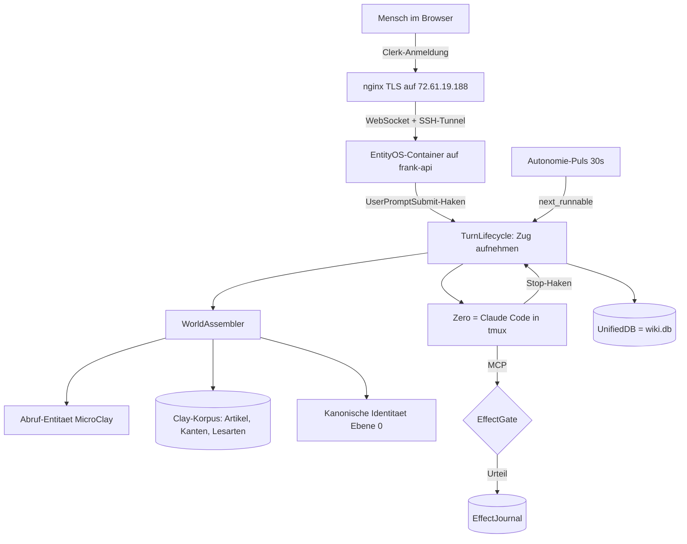

# EntityOS -- Architekturskizze

**Automatisch abgeleitet, nicht gepflegt.** Erzeugt 2026-08-18T13:48:59Z aus dem gemessenen
Zustand auf `frank-api`. Eine handgepflegte Skizze weicht nach zwei Wochen vom Code
ab und luegt dann still; diese kann das nicht, weil sie bei jedem Lauf neu aus Code,
Datenbank und laufenden Diensten entsteht.

## Die vier Namen

| Name | Was es ist |
|---|---|
| **EntityOS** | das Betriebssystem, der Container, das Produkt, das Frontend |
| **Zero** | die Entitaet selbst. Agent Zero. Wer im Terminal antwortet |
| **ClayCode** | Zeros Werkzeug, unveraendert |
| **Clay** | der Unterbau: Korpus, Graph, die vier Dienste |

## Der Weg eines Satzes



## Gemessener Bestand

| | |
|---|---|
| Produktmodule | 51 Dateien, 13775 Zeilen |
| Testdateien | 124 |
| Tabellen in der UnifiedDB | 129 |
| Artikel im Korpus | 16803 |
| Kanten | 99664 |
| Lesarten | 22567 |
| Zuege von Zero | 96 |
| Wirkungen durch das Tor | 2 |
| Abrufepisoden | 48 |
| gelernte Eintrittspunkte | 0 |
| Entitaetsgeneration | 89 |

## Laufende Clay-Dienste

```
clayverse-kern.service
clayverse-puls.service
clayverse-wikiarbeit.service
```

## Container

```
entityos:latest | user 5001:5001 | {"3000/tcp":[{"HostIp":"127.0.0.1","HostPort":"3000"}]}
```

## Werkzeuge, die Zero erreichen kann

```
(keine ermittelt)
```

## Ein Gefaess, zwei Schichten

Die Laufzeit-Wirbelsaeule (Zuege, Sitzungen, Wirkungen, Kausalitaet,
Abruf-Lernen) liegt in **derselben Datei** wie der Clay-Korpus. Keine
Namenskollision, gemessen. Die vier Clay-Dienste schreiben unveraendert weiter,
die Entitaet schreibt daneben -- eine Wahrheit, kein zweites Gedaechtnis.
