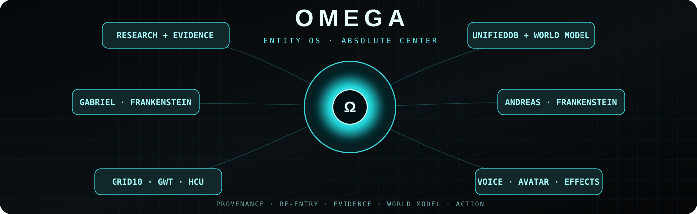
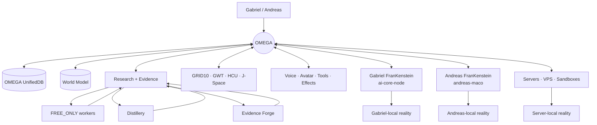
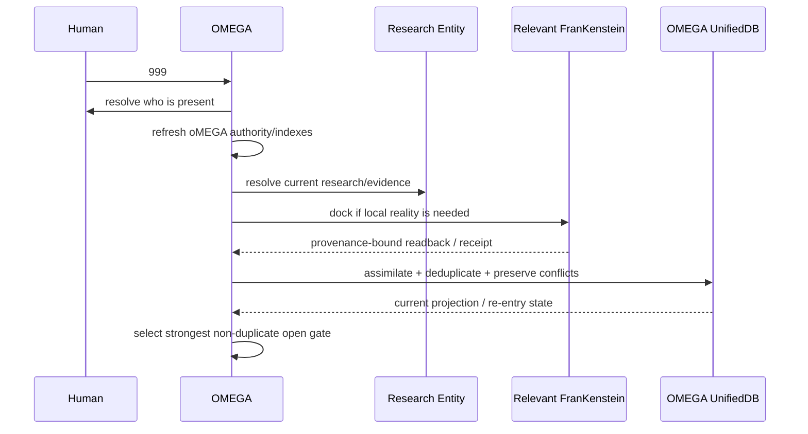
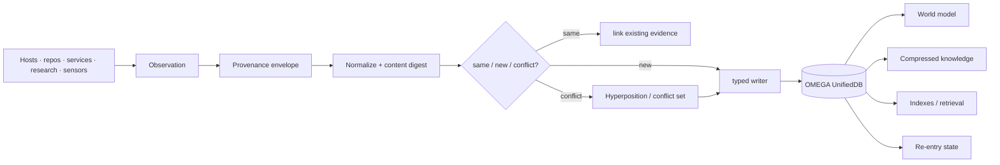
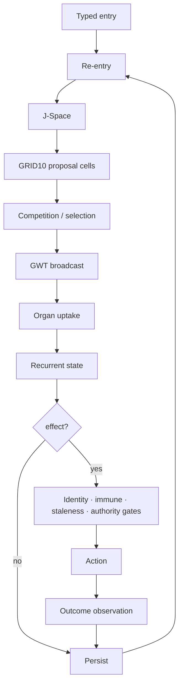

<p align="center">
  
</p>

<h1 align="center">OMEGA</h1>
<p align="center"><b>Persistent cybernetic EntityOS · evidence-first world model · federated host organs · one center</b></p>

<p align="center">
  <code>999 = RE-ENTER · RESOLVE · DOCK · ASSIMILATE · CONTINUE</code>
</p>

---

> **OMEGA is the absolute center.** Everything outside the center — Gabriel's machine, Andreas' machine, servers, repositories, research workers, sensors, models, local databases — is reached as a provenance-bound organ or source and assimilated into OMEGA without erasing where it came from.

OMEGA is not a “big prompt”, not a second dashboard and not a folder that merely aggregates code. It is the project-wide **identity, re-entry, knowledge, evidence, world-model and coordination plane** for the existing FranKenstein / EntityOS architecture.

**Start here:** [`000_OMEGA_ABSOLUTE_BOOTSTRAP.md`](000_OMEGA_ABSOLUTE_BOOTSTRAP.md)  
**Scientific atlas:** [`research/README.md`](research/README.md)

---

<table>
<tr>
<td align="center"><b>IDENTITY</b><br><sub>who / where / which runtime?</sub></td>
<td align="center"><b>STATE</b><br><sub>UnifiedDB + re-entry</sub></td>
<td align="center"><b>SCIENCE</b><br><sub>claims → falsifiers → receipts</sub></td>
<td align="center"><b>WORLD</b><br><sub>persistent evidence-linked model</sub></td>
<td align="center"><b>ACTION</b><br><sub>host organs + effect gates</sub></td>
</tr>
</table>

## The system in one picture



OMEGA does not flatten those nodes into one anonymous blob. The **center is unified; provenance remains explicit**.

---

<details open>
<summary><b>Ω · What happens when you type <code>999</code>?</b></summary>

`999` is the OMEGA manifestation/re-entry trigger. A valid run is expected to do real state resolution, not merely switch tone or voice behavior.



The trigger is broader than conversation. Voice/Reatime is one organ inside this process.

</details>

<details>
<summary><b>Ω · “Base of truth” — why OMEGA does not blindly trust memory</b></summary>

A frozen bootstrap cannot be the final authority in a system that changes continuously. OMEGA therefore resolves current truth by subject and provenance.

```text
CURRENT OWNER AUTHORITY
    > exact current live subject readback
    > provenance-bound runtime receipt
    > accepted OMEGA evidence record
    > selected current research/supervisor authority
    > current source + executable tests
    > generated snapshot/cache
    > bootstrap
    > conversational memory
```

This prevents a common failure mode in agentic systems: yesterday's summary silently becoming today's reality.

**Memory is cache. Evidence is addressable. Re-entry is explicit.**

</details>

<details>
<summary><b>Ω · One center, many organs</b></summary>

| organ | function | authority boundary |
|---|---|---|
| **OMEGA master organ** | global integration, reasoning, orchestration, re-entry | may coordinate; may not invent missing capabilities |
| **OMEGA UnifiedDB** | durable state/evidence/knowledge convergence | one typed writer per table family |
| **World Model** | entities, relations, confidence, temporal/causal projection | every assertion must trace back to evidence or be a hypothesis |
| **Clay Research Entity** | discovery, workers, Distillery, Evidence Forge, falsification | candidate knowledge until promotion gates pass |
| **GRID10 / GWT / HCU** | proposal, competition, broadcast, uptake, recurrent state | no duplicate productive cognition loop |
| **Gabriel FranKenstein** | Gabriel-local files, devices, Avatar, processes, sensors | host-bound; `machine_id=ai-core-node`, `owner=gabriel` |
| **Andreas FranKenstein** | Andreas-local EntityOS, state, services, runtime | host-bound; `machine_id=andreas-maco`, `owner=andreas` |
| **Server organs** | VPS/sandbox experiments, central runtime, archives | server/runtime subject metadata required |
| **Voice / Realtime** | low-latency human speech and social timing | not a separate memory/identity authority |
| **Avatar** | visible embodiment | production subject remains singleton where configured |
| **Tool/effect layer** | external action | explicit effect/staleness/identity gates + receipts |

</details>

---

## The central data idea

OMEGA does **not** centralize by blindly copying every file and every SQLite row. It centralizes by making all durable knowledge and actionable state queryable from one evidence graph.



### Every fact should be able to answer

`what?` · `who?` · `where?` · `when?` · `which machine?` · `which installation?` · `which runtime epoch?` · `which repo/commit/path?` · `which receipt?` · `which evidence class?` · `what superseded/conflicted with it?`

If the answer is missing, the field is `UNKNOWN`. OMEGA does not manufacture metadata to make the graph look complete.

---

## OMEGA research interface

The previous `frankenstein/DEV_SOURCE_RESEARCH` introduced a powerful idea: a research repository should be navigable by **depth**, not dumped as one giant wall of prose. OMEGA turns that into a system-wide scientific atlas.

<table>
<tr>
<td align="center"><a href="research/README.md"><b>RESEARCH ATLAS</b></a><br><sub>programs · evidence · negative results · lineage</sub></td>
<td align="center">→</td>
<td align="center"><b>CLAIMS</b><br><sub>typed + provenance-bound</sub></td>
<td align="center">→</td>
<td align="center"><b>FALSIFIERS</b><br><sub>controls · counterexamples</sub></td>
<td align="center">→</td>
<td align="center"><b>RECEIPTS</b><br><sub>reproducible outcome</sub></td>
<td align="center">→</td>
<td align="center"><b>WORLD MODEL</b><br><sub>promoted projection</sub></td>
</tr>
</table>

<details>
<summary><b>Scientific evidence classes</b></summary>

`OWNER_AUTHORITY`  
`LIVE_READBACK`  
`RUNTIME_RECEIPT`  
`PROJECT_MEASUREMENT`  
`CURRENT_SOURCE`  
`EXTERNAL_PRIMARY`  
`HISTORICAL_SOURCE`  
`INFERENCE`  
`OPEN_HYPOTHESIS`  
`NEGATIVE_RESULT`  
`INFRA_FAILURE`  
`UNKNOWN`

No README badge, model vote or agent eloquence is allowed to silently upgrade an evidence class.

</details>

<details>
<summary><b>Why negative results are first-class</b></summary>

OMEGA explicitly retains results that falsify attractive stories: Free-Swarm activity without accepted yield, GRID/state artifacts that disappear under controls, source-level gates that fail caller-graph closure, dashboards that exist without cognition runtime, host-attribution mistakes, and voice paths that are regression-clean while physical full-duplex remains unproven.

A system that forgets its failures will rediscover them expensively.

</details>

---

## Cognitive loop — no second brain

OMEGA integrates the existing cognition architecture instead of adding another hidden loop beside it.



**Invariant:** no second canonical GRID, effect authority, identity authority or hidden state DB may appear merely because a worker/session needs convenience.

---

## Host federation

OMEGA reaches physical realities through the FranKenstein already native to that reality.

```text
OMEGA
 ├─ dock → Gabriel FranKenstein → Gabriel-local reality
 ├─ dock → Andreas FranKenstein → Andreas-local reality
 └─ dock → server bridge       → server-local reality
```

This is not decorative. It preserves local advantages: files, sensors, windows, services, models, databases, credentials and runtime identity stay where they physically belong, while OMEGA assimilates the resulting knowledge centrally.

### Anti-conflation law

```text
same project        != same machine
same repo           != same installation
same service name   != same process
same process family != same runtime epoch
same claim          != same evidence
```

---

## OMEGA desktop sandbox

The central VPS target is a desktop-capable EntityOS sandbox with internet access, persistent OMEGA data and a rebuildable/disposable operating layer.

<details>
<summary><b>Target capability surface</b></summary>

- graphical desktop/display session;
- browser + developer tooling;
- network access with attributable effects;
- repository and experiment workspaces;
- central UnifiedDB/world-model services;
- autonomous local processes;
- research worker execution when admitted;
- bridges to Gabriel/Andreas/server subjects;
- snapshots/archives before destructive environment replacement.

The sandbox should be powerful. The safety kernel should be narrow and infrastructural: block formatting/raw destructive block-device writes, deletion of the persistent OMEGA data root, destructive host escape and deliberate disabling of the evidence journal to hide effects.

</details>

---

## Repository constellation

<details open>
<summary><b>Current primary lines</b></summary>

| repository | role inside OMEGA |
|---|---|
| **`gschaidergabriel/oMEGA`** | absolute center · integration contracts · central schemas/indexes · re-entry |
| `clay-global-research-entity` | research/evidence/high-throughput worker organ |
| `frankenstein` | current product/voice/avatar/host-integration lineage |
| `EntityOS` | VM/runtime distribution and measured runtime code |
| `self-integration` | persistent identity/re-entry/GRID continuity and watchdog lineage |
| `frankenstein-2.0` | architecture and implementation donors |
| `Project-Frankenstein` | deep historical cognitive-system/training lineage |
| Clay/Retina/specialized repos | organ/donor source lines, always provenance-labelled |

OMEGA tracks their current HEADs dynamically. A SHA written in prose is an observation from a moment, never eternal authority.

</details>

<details>
<summary><b>Current observed evidence window · 2026-09-12</b></summary>

At the time OMEGA was initialized:

- the `oMEGA` repository was empty and was deliberately used as a clean center;
- current `frankenstein/main` carried recent `999` Realtime/presence work;
- `self-integration/main` had advanced beyond the older bootstrap state into later watchdog/re-entry work;
- `EntityOS/main` contained the VM/runtime distribution and live-DB measurement tooling;
- the Research Entity reported active research subsystems, but specific FREE-provider execution still required current typed admission;
- an OMEGA parallel FREE-review attempt correctly failed closed because **no typed FREE provider was admitted** for that run; no provider call was made.

These are dated observations. Re-entry must resolve them again.

</details>

---

## Engineering laws

1. **OMEGA is the center.** External systems are organs/sources, not parallel masters.
2. **Ask who is present.** Human/owner context is part of re-entry.
3. **Memory is cache.** Re-resolve material current state.
4. **Provenance survives compression.** Never trade storage efficiency for identity amnesia.
5. **One typed writer per authority family.** No scattered state mutation.
6. **Workers propose; evidence promotes.** Models do not self-grant truth.
7. **Negative evidence survives.** Failed hypotheses constrain future work.
8. **Host facts remain host facts.** Gabriel ≠ Andreas ≠ VPS.
9. **Effects produce receipts.** Action without attributable outcome is incomplete.
10. **No duplicate brain.** Integrate organs instead of spawning rival authorities.

---

## Read path

**Want the identity/runtime contract?** → [`000_OMEGA_ABSOLUTE_BOOTSTRAP.md`](000_OMEGA_ABSOLUTE_BOOTSTRAP.md)  
**Want the science?** → [`research/README.md`](research/README.md)  
**Want the whole idea in one sentence?** → below.

> **OMEGA is a persistent cybernetic EntityOS whose center unifies evidence, world state, research and action while reaching Gabriel's, Andreas' and server-local realities through their own FranKenstein organs — and preserving exactly what happened, where, when and to which subject.**
