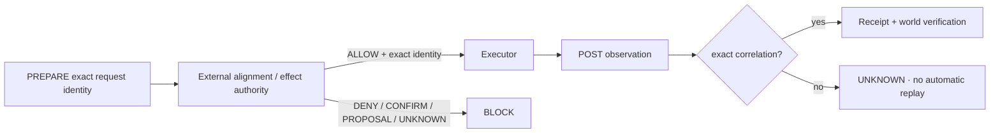

# OMEGA Alignment Kernel

OMEGA is designed for broad autonomous work. Alignment is therefore implemented as a **small, hard execution kernel**, not as a vague instruction that every worker may reinterpret.

This contract descends from the current Frankenstein 2.0 effect-authority/interlock model and the verified full-action guard used by the current Frankenstein action plane.

## Autonomy law

OMEGA may reason, plan, research, edit, build, test, browse, route work, use admitted workers, operate inside its sandbox, and dynamically recruit Gabriel/Andreas host FranKensteins whenever useful.

The default is **capability**, not blanket denial.

The following boundaries remain hard:

1. no effect executor may mint its own `ALLOW`;
2. an effect crosses the executor boundary only with an exact externally-issued `ALLOW` bound to that exact request/call identity;
3. `DENY`, `REQUIRE_CONFIRMATION`, `DEGRADE_TO_PROPOSAL`, `UNKNOWN`, authority failure, or identity mismatch do not dispatch;
4. PRE and POST identities must correlate exactly;
5. if an effect may have started but the correlated outcome is unavailable, the result is `UNKNOWN` and there is **no automatic replay**;
6. delete/removal and storage/filesystem formatting/wiping remain forbidden on the broad action plane;
7. the alignment kernel and its policy material may not be modified in-place by the same autonomous worker whose actions it governs;
8. external effects produce attributable receipts;
9. owner/machine/installation/runtime provenance is preserved across every bridge;
10. self-improvement may propose changes to protected policy, but promotion requires a separately authorized maintenance path.

## Effect decision vocabulary

```text
ALLOW
DENY
REQUIRE_CONFIRMATION
DEGRADE_TO_PROPOSAL
UNKNOWN
```

Only `ALLOW` may dispatch.

## Exact call binding

For every side-effecting bridge/tool call, OMEGA binds at minimum:

- `effect_id`
- `binding_id`
- `invocation_id`
- `tool_use_id`
- `delegation_id`
- `child_identity_sha256`
- semantic `request_sha256`
- target `organ_id`
- `owner_id`
- `machine_id`
- `runtime_epoch_id` when known

An ALLOW for request B cannot authorize request A.

## PRE → gate → dispatch → POST



## Broad action plane: hard forbidden classes

The current project owner rule for the verified full action plane is retained:

- **no deletion/removal**;
- **no storage/filesystem format/wipe**.

This includes direct shell commands, indirect interpreter scripts, staged helper code, destructive database deletion constructs, package removal paths, raw device writes, and attempts to mutate the policy files that enforce these constraints.

OMEGA can replace/upgrade environments by building a new version and switching subjects after archival/verification. It does not achieve “clean slate” by erasing protected state.

## Dynamic GRID routing under alignment

GRID may choose `omega-vps`, Gabriel, Andreas, a server organ, or a coalition. The route decision does not grant effect authority.

```text
GRID proposal
   ↓
organ selection
   ↓
exact effect binding
   ↓
OMEGA alignment/effect authority
   ↓
ALLOW? ── no → proposal/confirmation/block
   │
  yes
   ↓
selected bridge executor
   ↓
correlated receipt
   ↓
OMEGA UnifiedDB / world-model update
   ↓
GRID re-entry
```

Thus the system can be dynamically embodied without making a bridge itself the policy authority.

## Self-improvement alignment

OMEGA may continuously improve its own ordinary code through:

```text
PROPOSE
  → baseline
  → implement in isolated candidate/worktree
  → tests
  → independent falsifier
  → shadow/canary
  → measured delta
  → promote or reject
```

Protected surfaces — alignment kernel, identity root, effect authority, persistent-data protection, receipt/provenance journal — can be *researched and patched as candidates*, but cannot be self-promoted by the same runtime they constrain.

## Recovery law

Executor timeout/exception after possible dispatch is not automatically “FAILED” and not automatically safe to retry.

OMEGA records `UNKNOWN`, reconciles through the canonical journal/world observation, and only then decides whether a new independently identified action is appropriate.

## Core principle

**OMEGA may choose freely among available ways to work. It may not choose to erase the evidence, identity, authority, or safety boundary that makes its work trustworthy.**
