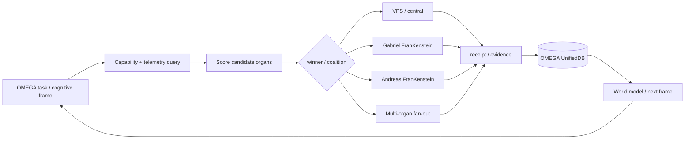

# Dynamic Organ Routing

OMEGA is the center, but **execution location is dynamic**.

The central VPS is OMEGA's persistent home. Gabriel's and Andreas' FranKensteins are first-class execution/cognition organs that OMEGA may recruit whenever doing so improves the task.

This is deliberately stronger than “use a local bridge only for local files”. OMEGA may route work to a host because that organ currently has better context, tools, models, sensors, compute, latency or a useful independent perspective.

## Routing loop



## Candidate organs

- `omega-vps` — persistent central EntityOS, UnifiedDB, world model, long-running cognition, research integration.
- `gabriel/ai-core-node` — Gabriel-local FranKenstein, production GUI/Avatar, local files/devices, GPU/desktop/browser and machine-specific context.
- `andreas/andreas-maco` — Andreas-local FranKenstein, Andreas' EntityOS/self-integration state, machine-specific files/services/context.
- admitted research workers — temporary candidate-generation/falsification organs; never canonical authority by themselves.

## Router input

Every organ advertises a short-lived capability/telemetry record:

```json
{
  "organ_id": "host:ai-core-node",
  "machine_id": "ai-core-node",
  "owner_id": "gabriel",
  "observed_at": "...",
  "health": "GREEN",
  "load": {"cpu": 0.0, "ram": 0.0, "gpu": 0.0},
  "capabilities": ["shell", "files", "browser", "desktop", "avatar", "gpu"],
  "data_domains": ["gabriel-local", "production-avatar"],
  "bridge": "chatgpt-local-ai-core-node-control/results",
  "receipt": "..."
}
```

Stale/unknown telemetry does not receive high-risk fan-out.

## Scoring dimensions

The router may combine:

- capability fit;
- data/context locality;
- freshness of local state;
- sensor/tool availability;
- expected latency;
- compute availability;
- host load and thermal/resource safety;
- expected information gain;
- independence value for falsification;
- owner/subject binding requirements;
- effect risk;
- reversibility;
- bridge health;
- current leases / duplicate-work risk.

No one scalar score is itself truth. The chosen route and the factors that dominated it are persisted in the frame/receipt.

## Coalitions

OMEGA may deliberately use more than one organ for the same cognitive problem:

```text
OMEGA central hypothesis
   ├─ Gabriel organ: implementation / local measurement
   ├─ Andreas organ: independent falsifier / alternate implementation
   └─ FREE_ONLY workers: breadth / counterhypotheses
             ↓
        evidence merge
             ↓
        GRID/GWT selection
             ↓
        OMEGA persistent state
```

This is not duplicated authority. It is parallel evidence generation under one central state/effect authority.

## Self-steering

OMEGA may use the local bridges as actuators for its own ongoing work. Example:

1. central cognition notices a missing measurement;
2. router sees that Gabriel's machine has the relevant GUI/GPU subject;
3. OMEGA dispatches a bounded command through Gabriel's FranKenstein bridge;
4. the local organ performs the observation/action;
5. the receipt returns with `machine_id`, `owner`, runtime/source metadata;
6. OMEGA assimilates it;
7. the next GRID/GWT frame continues from the new state.

The same applies to Andreas and server organs.

## Safety / admission

Dynamic does not mean blind.

- Local fan-out requires fresh host telemetry for resource-intensive work.
- Unknown/red telemetry fails closed for heavy execution.
- Owner/host attribution is checked from payload and receipt, not inferred only from branch names.
- Formatting/destructive storage operations and deletion of protected persistent roots remain blocked.
- Effects remain attributable and receipt-producing.
- OMEGA may reroute when an organ becomes stale, busy or unavailable.

## Invariant

**OMEGA chooses where to think and act; OMEGA does not choose where truth came from. Provenance decides that.**
