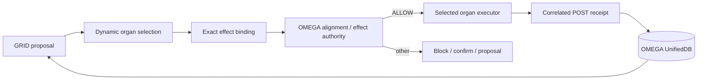

# OMEGA Architecture

OMEGA is one center with dynamically recruited organs.

| contract | purpose |
|---|---|
| [`ALIGNMENT_KERNEL.md`](ALIGNMENT_KERNEL.md) | immutable execution boundary: exact external ALLOW, PRE/POST correlation, UNKNOWN recovery, no delete/format |
| [`DYNAMIC_ORGAN_ROUTING.md`](DYNAMIC_ORGAN_ROUTING.md) | GRID chooses where cognition/effects execute: VPS, Gabriel, Andreas, or a coalition |
| [`../000_OMEGA_ABSOLUTE_BOOTSTRAP.md`](../000_OMEGA_ABSOLUTE_BOOTSTRAP.md) | identity, truth resolution, 999 re-entry and absolute-center law |
| [`../research/README.md`](../research/README.md) | evidence graph, research programs, negative results and promotion law |

## Runtime invariant

**GRID controls embodiment. Alignment controls whether an effect may cross the boundary. Provenance controls what OMEGA may claim happened.**
