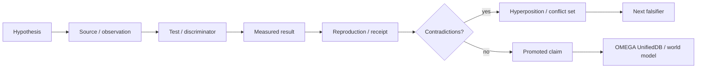

# OMEGA Research Atlas

> A living scientific interface over the OMEGA evidence graph. Open only the depth you need.

OMEGA does not treat prose as proof. Every implementation-significant claim should descend to a source, receipt, measurement, experiment or explicit hypothesis.

**Evidence classes**  
`OWNER_AUTHORITY` · `LIVE_READBACK` · `RUNTIME_RECEIPT` · `PROJECT_MEASUREMENT` · `CURRENT_SOURCE` · `EXTERNAL_PRIMARY` · `HISTORICAL_SOURCE` · `INFERENCE` · `OPEN_HYPOTHESIS` · `NEGATIVE_RESULT` · `INFRA_FAILURE` · `UNKNOWN`

---

<table>
<tr>
<td align="center"><b>OBSERVE</b> hosts · repos · sensors · runtimes</td>
<td align="center">→</td>
<td align="center"><b>CLAIM</b> typed statement + provenance</td>
<td align="center">→</td>
<td align="center"><b>FALSIFY</b> controls · counterexamples</td>
<td align="center">→</td>
<td align="center"><b>PROMOTE</b> only after evidence gates</td>
<td align="center">→</td>
<td align="center"><b>RE-ENTER</b> state survives the session</td>
</tr>
</table>

<b>01 · The shortest serious path</b>

1. [`../000_OMEGA_ABSOLUTE_BOOTSTRAP.md`](../000_OMEGA_ABSOLUTE_BOOTSTRAP.md) — identity, authority and 999 re-entry law.
2. [`#research-programs`](#research-programs) — the active scientific programs OMEGA must continuously reconcile.
3. [`#evidence-promotion`](#evidence-promotion) — how a claim becomes stronger without being inflated.
4. [`#negative-results`](#negative-results) — failures that constrain the architecture.
5. [`#source-lineage`](#source-lineage) — exact upstream research repositories and donor lines.

<b>02 · Research programs</b>

| program | core question | OMEGA target |
|---|---|---|
| **Identity & re-entry** | Can one entity preserve continuity across sessions, installations and epochs without conflating subjects? | explicit Entity / Installation / HostBinding / RuntimeEpoch lineage |
| **UnifiedDB** | Can durable state, research evidence and operational state share one substrate without authority collapse? | typed one-door writes + provenance envelopes + conflict sets |
| **World model** | Can OMEGA maintain an evidence-reconstructable model of people, machines, repos, services, goals and outcomes? | persistent graph/projection with confidence and temporal causality |
| **GRID10 / GWT / HCU** | Can proposal → competition → broadcast → uptake → re-entry produce measurable state-sensitive behavior? | runtime receipts, controls, causal discriminators |
| **J-Space / Hyperposition / GRF** | Can unresolved alternatives remain explicit until evidence excludes them? | branch-preserving inference instead of forced early collapse |
| **ClayCode / Xeno** | Can typed model-facing semantics replace ad-hoc prompt/runtime glue? | executable protocol + deterministic carrier boundaries |
| **Voice / Realtime** | Can low-latency speech be fused with persistent identity, tools, affect and initiative? | human-grade interaction without creating a second state authority |
| **Avatar / embodiment** | Can visual embodiment become a measured organ rather than a disconnected skin? | single production subject + state-grounded expression |
| **Autonomous research** | Can cheap/free worker swarms create useful deltas without self-granting truth? | FREE_ONLY admission + Distillery + Evidence Forge + receipts |
| **Host federation** | Can OMEGA exploit local machines while preserving exact host ownership and identity? | dock through local FranKensteins, never flatten provenance |

<b>03 · Evidence promotion</b>

Promotion rules:

- prose never promotes itself;
- a source-level repair is not a runtime PASS;
- a component PASS is not a whole-system PASS;
- an infrastructure failure is not a product failure;
- a current receipt can supersede a stale snapshot, but the stale record remains part of history;
- popularity, model prestige, citation count and rhetorical confidence are not evidence multipliers;
- negative results are first-class architecture constraints.

<b>04 · Negative results</b>

OMEGA deliberately preserves failures that changed the design:

- Free Swarm produced very large historical token volume while accepted knowledge/dataset yield remained near zero in important windows; activity is not accepted science.
- Earlier GRID10 state-weight effects survived frozen-state controls in ways consistent with formula/position artifacts; apparent recurrence is not automatically causal recurrence.
- A historical repetition signal was initially overestimated before replay/analysis corrections reduced it close to chance-scale behavior.
- Provider/source gates have previously looked closed locally while fallback paths still existed elsewhere in the caller graph.
- A production-looking dashboard can exist while the actual cognition runtime remains off; UI reachability is not cognition evidence.
- Voice can pass source/regression gates while true acoustic full-duplex interruption remains unproven because echo-cancellation/duplex physics are separate constraints.
- Host attribution can be wrong even on the “right” bridge branch if environment identity is misconfigured; payload-level machine/owner metadata therefore remains mandatory.

These are not embarrassing footnotes. They are part of the control law.

<b>05 · Scientific object model</b>

Every research object should be machine-addressable as one of:

`CLAIM` · `HYPOTHESIS` · `OBSERVATION` · `EXPERIMENT` · `CONTROL` · `MEASUREMENT` · `NEGATIVE_RESULT` · `SOURCE` · `RECEIPT` · `ARTIFACT` · `IMPLEMENTATION_DELTA` · `OPEN_QUESTION`

Minimum relation vocabulary:

`supports` · `contradicts` · `supersedes` · `reproduces` · `measures` · `implements` · `derived_from` · `observed_on` · `bound_to_runtime` · `invalidates` · `opens_question`

This graph should eventually project automatically into the README, dashboards and OMEGA world model.

<b>06 · Source lineage</b>

The current OMEGA atlas descends from several non-equivalent source lines:

- `gschaidergabriel/frankenstein/DEV_SOURCE_RESEARCH` — current product-facing research compendium, evidence rules, system autopsy, UnifiedDB, Hyperposition, ClayCode, agentic architecture, self-reflection, training, measurements and negative results.
- `gschaidergabriel/clay-global-research-entity` — high-throughput research entity, current-state pyramid, Supervisor/authority files, Free Swarm, Distillery, Evidence Forge, ClayCode/EntityOS/HCU research and receipts.
- `gschaidergabriel/self-integration` — persistent identity/re-entry/GRID continuity and regression-watch lineage.
- `gschaidergabriel/EntityOS` — VM/runtime distribution, single-UnifiedDB design and measured voice/runtime code.
- `gschaidergabriel/frankenstein-2.0` — architecture and implementation donors from the self-integration transition.
- `gschaidergabriel/Project-Frankenstein` — deeper historical cognitive-system and training lineage.

OMEGA does not copy these histories blindly. It indexes, compresses and links them with exact provenance.

<b>07 · External comparison frame</b>

OMEGA should compare mechanisms, not branding. Relevant external lines include Global Workspace architectures, ReAct-style action loops, Reflexion-style outcome feedback, MemGPT-style memory hierarchy, HRR/vector-symbolic binding, model-based control, active inference, cybernetic regulation, blackboard systems, event sourcing and distributed-systems lineage/provenance techniques.

External literature is `EXTERNAL_PRIMARY` or secondary evidence for a mechanism. It does not prove that OMEGA implements the mechanism correctly.

---

## Research reading law

**If a claim matters enough to alter code, authority or persistent state, descend until you reach exact evidence.** If exact evidence is missing, label the statement `OPEN_HYPOTHESIS` or `UNKNOWN` and design the cheapest falsifier.
